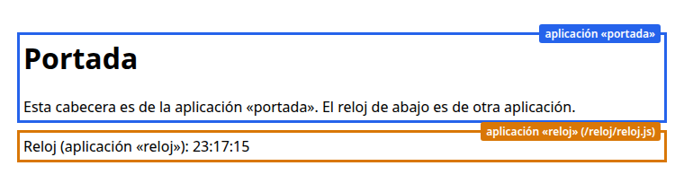

# Una página, dos aplicaciones

[← Página anterior](00-del-monolito-a-microfrontends.md) · [Siguiente página →](02-lab-despliegue-independiente.md)

Esta demostración enseña la **composición en el navegador** con el ejemplo más pequeño posible: una página con
una cabecera que pertenece a una aplicación React (`portada`) y un reloj que pertenece a otra (`reloj`). Cada una
tiene su propio `webpack.config.js`, se construye por separado y publica su fichero en su carpeta. El navegador es
quien las junta.

## Punto de partida

- Carpeta del ejercicio: `ejercicios/M01-01-una-pagina-dos-aplicaciones/` (no tiene `inicio/` ni `solucion/`: es
  una demostración).
- Dependencias: instaladas en la raíz del repositorio al crear el Codespace (`npm ci`).
- Puerto: **3000**, que se abre desde la pestaña **Puertos** de VS Code (icono del globo, «Abrir en el
  navegador»). Fuera de Codespaces, `http://localhost:3000`.
- Estado: nada construido todavía; la carpeta `publicado/` se crea en el recorrido.

| Carpeta | Qué es |
|---------|--------|
| `portada/` | Aplicación React que pinta la cabecera y deja un hueco `<div id="reloj">` en su HTML |
| `reloj/` | Aplicación React que se monta sola en ese hueco y actualiza la hora cada segundo |
| `publicado/` | Lo que se serviría en producción: lo que escribe el build de cada aplicación |

## Recorrido

### 1 — Las dos aplicaciones y el hueco que las une

La `portada` es una aplicación React normal: su `index.js` monta el componente `Portada` en `#root`.

```jsx
// portada/src/index.js
import { createRoot } from 'react-dom/client';

function Portada() {
  return (
    <header>
      <h1>Portada</h1>
      <p>Esta cabecera es de la aplicación «portada». El reloj de abajo es de otra aplicación.</p>
    </header>
  );
}

createRoot(document.getElementById('root')).render(<Portada />);
```

Lo que la conecta con la otra aplicación no está en su JavaScript, sino en su HTML: un hueco vacío y una etiqueta
`<script>` que apunta a una URL que la `portada` no construye.

```html
<!-- portada/public/index.html -->
<body>
  <div id="root"></div>
  <!-- Hueco que rellena otra aplicación, construida y publicada aparte -->
  <div id="reloj"></div>
  <script src="/reloj/reloj.js" defer></script>
</body>
```

El `reloj` es otra aplicación React, con su propio `createRoot`, que busca ese hueco y se monta en él:

```jsx
// reloj/src/index.js
import { useEffect, useState } from 'react';
import { createRoot } from 'react-dom/client';

function Reloj() {
  const [hora, setHora] = useState(new Date());
  useEffect(() => {
    const id = setInterval(() => setHora(new Date()), 1000);
    return () => clearInterval(id);
  }, []);
  return <p>Reloj (aplicación «reloj»): {hora.toLocaleTimeString('es-ES')}</p>;
}

// La aplicación se monta sola en el hueco que le deja la página.
createRoot(document.getElementById('reloj')).render(<Reloj />);
```

Ninguna de las dos importa nada de la otra. El único [contrato](../glosario/01-arquitectura.md#contrato) entre ambas es el `id="reloj"` del hueco y la URL
`/reloj/reloj.js`.

### 2 — Dos builds, dos salidas

Cada `webpack.config.js` escribe en un sitio distinto de `publicado/`, y con una diferencia importante en el nombre
del fichero:

```js
// portada/webpack.config.js (extracto)
output: {
  path: path.resolve(__dirname, '../publicado'),   // dónde se publica
  filename: '[name].[contenthash:8].js',           // nombre con hash del contenido
  clean: true,
},
```

```js
// reloj/webpack.config.js (extracto)
output: {
  path: path.resolve(__dirname, '../publicado/reloj'),   // dónde se publica
  filename: 'reloj.js',                                  // nombre fijo: la portada lo pide siempre igual
  clean: true,
},
```

La `portada` lleva un hash en el nombre porque su propio `index.html` (generado con `HtmlWebpackPlugin`) se
reescribe en cada build con el nombre nuevo. El `reloj` no puede hacer eso: quien lo pide es el HTML de otra
aplicación, así que se publica siempre en la misma URL.

El `package.json` del ejercicio lanza los dos builds uno detrás de otro:

```bash
# Desde la raíz del repositorio, entra en la carpeta de la demostración
cd /workspaces/react-microfrontends-201/ejercicios/M01-01-una-pagina-dos-aplicaciones
# Construye la portada y después el reloj (script "build" del package.json)
npm run build
```

Resultado (el hash y los tiempos pueden cambiar en cada ejecución):

```text
> build
> npm run build --prefix portada && npm run build --prefix reloj
> build
> NODE_ENV=production webpack
asset main.c9b434fd.js 214 KiB [emitted] [immutable] [minimized] (name: main) 1 related asset
asset index.html 257 bytes [emitted] [minimized]
webpack 5.112.2 compiled successfully in 2763 ms
> build
> NODE_ENV=production webpack
asset reloj.js 214 KiB [emitted] [minimized] (name: main) 1 related asset
webpack 5.112.2 compiled successfully in 2101 ms
```

| Línea | Qué dice |
|-------|----------|
| `asset main.c9b434fd.js 214 KiB … [immutable]` | El bundle de la `portada`, con hash: Webpack lo marca como inmutable (si cambia el código, cambia el nombre) |
| `asset index.html 257 bytes` | El HTML de la `portada`, ya con el `<script>` de `main.c9b434fd.js` |
| `asset reloj.js 214 KiB` | El bundle del `reloj`, sin hash y sin `[immutable]` |

Las dos aplicaciones pesan lo mismo, **214 KiB**, aunque una solo pinta un título y la otra una hora. Casi todo ese
peso es React y React DOM: cada aplicación lleva su propia copia.

```bash
# Lista lo que ha quedado publicado
find publicado -type f | sort
```

```text
publicado/index.html
publicado/main.c9b434fd.js
publicado/main.c9b434fd.js.LICENSE.txt
publicado/reloj/reloj.js
publicado/reloj/reloj.js.LICENSE.txt
```

La carpeta `reloj/` es del segundo build. En producción podrían ser dos servidores o dos rutas de un CDN: basta con
que `/reloj/reloj.js` responda en el mismo dominio que la página.

### 3 — Servir lo publicado y abrirlo en el navegador

`npm start` en esta carpeta no arranca un servidor de desarrollo: sirve tal cual la carpeta `publicado/`, como lo
haría un servidor web en producción (script `"start": "serve publicado -l 3000"`).

```bash
# Sirve la carpeta publicado/ en el puerto 3000 (Ctrl+C para pararlo)
npm start
```

Resultado (la IP de `Network` depende de la máquina):

```text
   ┌──────────────────────────────────────────┐
   │                                          │
   │   Serving!                               │
   │                                          │
   │   - Local:    http://localhost:3000      │
   │   - Network:  http://10.181.73.90:3000   │
   │                                          │
   └──────────────────────────────────────────┘
```

Puede aparecer también el aviso `Cannot copy server address to clipboard`: en Codespaces no hay portapapeles y no
tiene importancia.

Con la página abierta (pestaña **Puertos** → 3000 → globo) y las herramientas del navegador en **F12** → pestaña
**Red** (Network), al recargar se ven dos ficheros de JavaScript:

```text
Red      200  /reloj/reloj.js
Red      200  /main.c9b434fd.js
```

Y en la página (la hora es la del momento y avanza cada segundo):

```text
Portada

Esta cabecera es de la aplicación «portada». El reloj de abajo es de otra aplicación.

Reloj (aplicación «reloj»): 12:10:17
```



| Lo que se ve | De dónde sale |
|--------------|---------------|
| `main.c9b434fd.js` | Build de la `portada`; pinta el título y el párrafo en `#root` |
| `reloj/reloj.js` | Build del `reloj`; se monta en `#reloj` y cambia cada segundo |
| Una sola página | El navegador ejecuta los dos scripts y cada uno rellena su hueco |

Para el usuario es una única página; para el servidor son dos aplicaciones publicadas en dos rutas. Eso es la
composición en el navegador.

## Qué queda visto

- Dos aplicaciones React sin ningún import entre ellas se componen en una página con un hueco (`#reloj`) y una
  etiqueta `<script>` que apunta a una URL fija.
- Cada aplicación tiene su build y su carpeta de publicación; la pestaña **Red** muestra un fichero por aplicación.
- La aplicación que contiene la página publica con hash (`main.c9b434fd.js`), porque ella misma reescribe su HTML.
  La que se incrusta publica en una URL fija (`reloj.js`), porque la pide otra aplicación.
- Cada bundle pesa 214 KiB: cada aplicación trae su propia copia de React.

Si el reloj se publica en una URL fija y la portada no lo recompila, ¿qué hay que volver a construir y publicar
cuando cambia el código de una de las dos partes, y qué pasaría si esa parte fuese el código de un [monolito](../glosario/01-arquitectura.md#monolito)? Eso es
lo que se comprueba en [02 — Lab: despliegue independiente](02-lab-despliegue-independiente.md).
