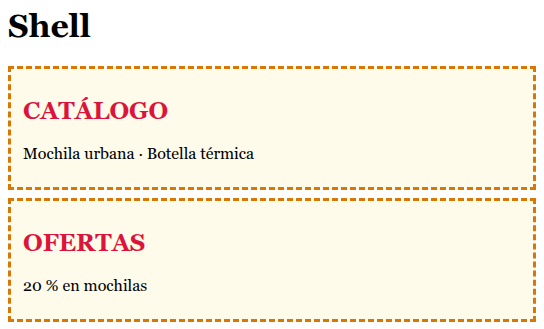
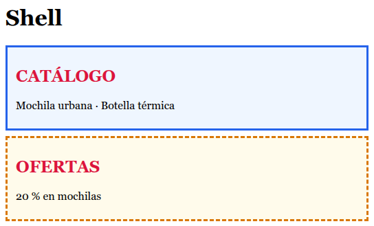
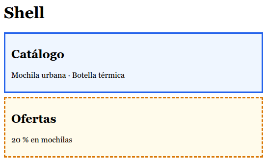

# Lab — Aislamiento de estilos

[← Página anterior](03-lab-shell-sin-framework.md) · [Siguiente página →](05-cinco-integraciones.md)

En este laboratorio practicas el **aislamiento de estilos** entre [microfrontends](../glosario/01-arquitectura.md#microfrontend). El ejercicio es un [shell](../glosario/01-arquitectura.md#shell) que
monta a la vez dos microfrontends, **catálogo** y **ofertas**, hechos por equipos distintos. Los dos han llamado
`.tarjeta` a su recuadro y el shell tiene una regla para todos los `h2` de la página. El CSS de cada uno se cuela
en los demás. Lo resuelves primero con prefijos y después con [Shadow DOM](../glosario/01-arquitectura.md#shadow-dom), y compruebas qué consigue cada
técnica y qué no.

### Objetivo

Comprender por qué el CSS es global en una página con varios microfrontends, cómo se detecta una colisión de
estilos, qué protege un prefijo de clases, qué protege el Shadow DOM y qué sigue atravesándolo.

### Punto de partida

- Carpeta: [`ejercicios/M01-04-aislamiento-de-estilos/inicio/`](../../ejercicios/M01-04-aislamiento-de-estilos/inicio/).
  La solución terminada está en [`solucion/`](../../ejercicios/M01-04-aislamiento-de-estilos/solucion/).
- Estado: dependencias instaladas en la raíz del repositorio. No hay nada que compilar.
- Arranque y URL: `npm start` en `inicio/`, puerto **3000** (pestaña **Puertos** de VS Code, icono del globo;
  fuera de Codespaces, `http://localhost:3000`).
- Qué se ve al abrir: el título **Shell** y dos recuadros, **CATÁLOGO** y **OFERTAS**.

Si quieres empezar de cero:

```bash
# Desde la raíz del repositorio: deja inicio/ como en el repositorio (ficha: ../comandos-lab.md#reiniciar)
bash scripts/reiniciar.sh M01-04-aislamiento-de-estilos
```

Ficha: [`reiniciar.sh`](../comandos-lab.md#reiniciar).

### Qué está pasando

En una página solo hay un juego de reglas CSS. Da igual qué equipo escriba una regla o dónde la cargue: si el
selector coincide con un elemento, se aplica. Con un solo equipo eso se controla con convenciones; con varios
microfrontends en la misma página, cada uno publicado por su lado, una clase con nombre común o una regla de
etiqueta (`h2 { … }`) afecta a todos.

| Pieza | En la realidad | En este laboratorio |
|-------|----------------|---------------------|
| CSS del shell | Estilos de la página principal o de un tema corporativo | `h2 { color: crimson; text-transform: uppercase; }` en `index.html` |
| CSS de un microfrontend | La hoja de estilos de cada equipo | Un `<style>` que cada `mfe.js` añade al montarse |
| Colisión | Dos equipos que usan el mismo nombre de clase | `.tarjeta` en los dos microfrontends |

### 1 — Arranca y mira los dos recuadros

Arranca el servidor estático en `inicio/` ([ficha de `npm start`](../comandos-lab.md#npm-start)).

```bash
# Entra en el punto de partida y sirve la carpeta en el puerto 3000 (Ctrl+C para pararlo)
cd /workspaces/react-microfrontends-201/ejercicios/M01-04-aislamiento-de-estilos/inicio
npm start
```

**Resultado esperado:**

```text
   ┌──────────────────────────────────────────┐
   │                                          │
   │   Serving!                               │
   │                                          │
   │   - Local:    http://localhost:3000      │
   │   - Network:  http://10.181.73.90:3000   │
   │                                          │
   └──────────────────────────────────────────┘
```

Abre el puerto 3000. Los dos recuadros tienen el mismo borde naranja discontinuo y los títulos salen en
mayúsculas y en rojo:



El catálogo debería tener un borde azul continuo. Compruébalo en la **Consola** (**F12** → **Console**), una
expresión cada vez:

```js
// Estilo que el navegador aplica de verdad al recuadro y al título del catálogo, y hojas de estilo del <head>
getComputedStyle(document.querySelector('#catalogo .tarjeta')).borderTopStyle
getComputedStyle(document.querySelector('#catalogo h2')).color
document.querySelectorAll('head style').length
```

**Resultado esperado:**

```text
'dashed'
'rgb(220, 20, 60)'
3
```

| Valor | Qué significa |
|-------|---------------|
| `'dashed'` en el catálogo | Gana la regla `.tarjeta` de ofertas: se añadió después y tiene el mismo selector |
| `rgb(220, 20, 60)` | Es `crimson`: la regla `h2` del shell se aplica al título del microfrontend |
| `3` | Tres `<style>` en el `<head>`: el del shell y uno por microfrontend, todos globales |

### 2 — Lee el CSS de los dos microfrontends

Abre `inicio/catalogo/mfe.js` y `inicio/ofertas/mfe.js`. Los dos hacen lo mismo con su CSS:

```js
// catalogo/mfe.js (ofertas/mfe.js es igual, con borde naranja discontinuo)
const CSS = `
  .tarjeta { border: 3px solid #2563eb; background: #eff6ff; padding: 8px 12px; margin: 8px 0; }
`;

export function mount(contenedor) {
  const estilo = document.createElement('style');
  estilo.textContent = CSS;
  document.head.appendChild(estilo);             // el CSS va al <head> de la página: es global
  contenedor.innerHTML = '<section class="tarjeta"><h2>Catálogo</h2><p>Mochila urbana · Botella térmica</p></section>';
}
```

Cada equipo ha probado su microfrontend solo y se veía bien. El fallo aparece al juntarlos.

### 3 — Pon un prefijo a las clases de cada microfrontend

La solución más común es una convención: cada microfrontend prefija sus clases con su nombre. En
`inicio/catalogo/mfe.js`, cambia `.tarjeta` por `.catalogo-tarjeta` en el CSS y `class="tarjeta"` por
`class="catalogo-tarjeta"` en el HTML. Haz lo mismo en `inicio/ofertas/mfe.js` con `ofertas-tarjeta`.

```js
// catalogo/mfe.js — la clase lleva el nombre del microfrontend
const CSS = `
  .catalogo-tarjeta { border: 3px solid #2563eb; background: #eff6ff; padding: 8px 12px; margin: 8px 0; }
`;
// … y en mount:
  contenedor.innerHTML = '<section class="catalogo-tarjeta"><h2>Catálogo</h2><p>Mochila urbana · Botella térmica</p></section>';
```

Guarda los dos ficheros y recarga. Comprueba en la **Consola**:

```js
// Borde de cada recuadro y color del título del catálogo
getComputedStyle(document.querySelector('#catalogo .catalogo-tarjeta')).borderTopStyle
getComputedStyle(document.querySelector('#ofertas .ofertas-tarjeta')).borderTopStyle
getComputedStyle(document.querySelector('#catalogo h2')).color
```

**Resultado esperado:**

```text
'solid'
'dashed'
'rgb(220, 20, 60)'
```



Los recuadros ya no se pisan entre ellos. Los títulos siguen en rojo y mayúsculas: el prefijo protege de otros
microfrontends que respeten la convención, no de una regla de etiqueta del shell ni de quien no la cumpla.

### 4 — Monta cada microfrontend en su propio Shadow DOM

El Shadow DOM da a un elemento un árbol propio: las reglas CSS de dentro solo se aplican dentro, y las de la
página no entran. Sustituye la función `mount` de `inicio/catalogo/mfe.js` y vuelve a llamar `.tarjeta` a la
clase (ya no hace falta prefijo):

```js
// catalogo/mfe.js
// Microfrontend «catalogo»: su CSS vive dentro de su Shadow DOM, no en la página.
const CSS = `
  .tarjeta { border: 3px solid #2563eb; background: #eff6ff; padding: 8px 12px; margin: 8px 0; }
`;

export function mount(contenedor) {
  // Shadow DOM: un árbol propio dentro del hueco. Su CSS no sale y el CSS de la página no entra.
  const sombra = contenedor.shadowRoot ?? contenedor.attachShadow({ mode: 'open' });
  sombra.innerHTML = `<style>${CSS}</style><section class="tarjeta"><h2>Catálogo</h2><p>Mochila urbana · Botella térmica</p></section>`;
}
```

Haz el mismo cambio en `inicio/ofertas/mfe.js`, con su CSS y su texto. `attachShadow` solo se puede llamar una
vez por elemento: por eso se reutiliza `contenedor.shadowRoot` si ya existe.

### 5 — Comprueba qué entra y qué sale

Recarga. Ahora, para llegar a los elementos de un microfrontend hay que entrar en su `shadowRoot`:

```js
// Borde de cada recuadro, color del título y hojas de estilo del <head>
getComputedStyle(document.querySelector('#catalogo').shadowRoot.querySelector('.tarjeta')).borderTopStyle
getComputedStyle(document.querySelector('#ofertas').shadowRoot.querySelector('.tarjeta')).borderTopStyle
getComputedStyle(document.querySelector('#catalogo').shadowRoot.querySelector('h2')).color
document.querySelectorAll('head style').length
document.querySelector('#catalogo h2')
```

**Resultado esperado:**

```text
'solid'
'dashed'
'rgb(0, 0, 0)'
1
null
```



| Valor | Qué significa |
|-------|---------------|
| `'solid'` y `'dashed'` con la misma clase `.tarjeta` | Cada regla solo se aplica dentro de su Shadow DOM |
| `rgb(0, 0, 0)` en el título | La regla `h2` del shell ya no entra |
| `1` hoja en el `<head>` | Los microfrontends ya no añaden CSS a la página |
| `null` | `document.querySelector` no ve dentro del Shadow DOM: el aislamiento vale también para el JavaScript del shell |

## Comprueba tu entendimiento

**El Shadow DOM en el inspector**
Abre la pestaña **Elementos** (Elements) y despliega `<div id="catalogo">`.
→ Aparece `#shadow-root (open)` y, dentro, el `<style>` y la `<section>` del microfrontend.

**La clase se puede repetir**
Busca `.tarjeta` en los dos `mfe.js`.
→ Los dos usan el mismo nombre y cada recuadro conserva su borde.

**El shell no puede romperlos**
Añade en el `<style>` de `index.html` la regla `.tarjeta { border: 0; }` y recarga.
→ Los dos recuadros siguen con su borde: la regla de la página no cruza el Shadow DOM. Quítala después.

## Investiga

**¿Por qué los títulos siguen en Georgia?** El shell declara `body { font-family: Georgia, serif; }` y los títulos
de los dos microfrontends siguen saliendo con esa fuente. Mira la fuente calculada del título:

```js
// Fuente que el navegador aplica al título del catálogo, dentro del Shadow DOM
getComputedStyle(document.querySelector('#catalogo').shadowRoot.querySelector('h2')).fontFamily
```

**Resultado esperado:**

```text
'Georgia, serif'
```

El Shadow DOM aísla los **selectores**: ninguna regla de fuera se aplica a un elemento de dentro. Pero las
propiedades **heredadas** (`font-family`, `color`, `line-height`…) pasan de padre a hijo por el árbol, y el hueco
`#catalogo` es hijo del `body`. Busca en la pestaña **Elementos**, panel **Calculado** (Computed), la propiedad
`font-family` del `h2` y fíjate en de dónde dice que viene. ¿Qué haría falta en el CSS del microfrontend para no
heredarla?

## Experimenta

**¿Qué pasa si un microfrontend sigue escribiendo en el `<head>`?** Predice antes: con los dos microfrontends en
Shadow DOM, si en `ofertas/mfe.js` vuelves a añadir su `<style>` al `<head>` (como en el punto de partida), ¿cambia
algo en el catálogo?

Añade estas tres líneas al principio de `mount` en `ofertas/mfe.js`, recarga y mira el catálogo.

```js
// ofertas/mfe.js — experimento: además de su Shadow DOM, deja su CSS en la página
const estilo = document.createElement('style');
estilo.textContent = CSS;
document.head.appendChild(estilo);
```

El catálogo no cambia: la regla `.tarjeta` de ofertas está ahora en la página, pero no llega a lo que hay dentro
del Shadow DOM del catálogo. Lo que sí afectaría es a cualquier `.tarjeta` del propio shell. Quita las tres
líneas.

## Reto

### 1 — Un color de marca que sí cruce

**La situación:** la empresa cambia su color corporativo y el shell quiere que todos los microfrontends lo usen en
sus bordes, sin que cada equipo publique una versión nueva cada vez. Con el Shadow DOM, las reglas del shell ya
no entran.

**Qué haces:** en el `<style>` de `inicio/index.html`, define una propiedad personalizada
`--color-marca: #059669` en `:root`. En `catalogo/mfe.js`, haz que el borde la use, con el azul de antes como
valor por defecto.

**Pistas:** las propiedades personalizadas de CSS (`--algo`) se heredan como `font-family`. `var(--algo, valor)`
usa el valor por defecto si no está definida.

**Lo que buscas:** el borde del catálogo pasa a verde y, si quitas la línea de `:root`, vuelve al azul.

<details>
<summary>Ver solución</summary>

```css
/* index.html — el shell publica el color de marca */
:root { --color-marca: #059669; }
```

```js
// catalogo/mfe.js — el microfrontend lo usa y tiene su valor si no lo hay
const CSS = `
  .tarjeta { border: 3px solid var(--color-marca, #2563eb); background: #eff6ff; padding: 8px 12px; margin: 8px 0; }
`;
```

```js
// En la Consola: color del borde del catálogo
getComputedStyle(document.querySelector('#catalogo').shadowRoot.querySelector('.tarjeta')).borderTopColor
```

```text
'rgb(5, 150, 105)'
```

La propiedad personalizada cruza el Shadow DOM porque se hereda. Es un [contrato](../glosario/01-arquitectura.md#contrato) de tema: el shell decide el
valor; el microfrontend decide dónde lo usa y qué hacer si no está. **La regla:** aísla los selectores con
Shadow DOM y comparte el tema con propiedades personalizadas documentadas, no con reglas globales.

</details>

## Errores frecuentes

| Síntoma | Causa probable | Cómo arreglarlo |
|---------|----------------|-----------------|
| `NotSupportedError: Failed to execute 'attachShadow' on 'Element': Shadow root cannot be created on a host which already hosts a shadow tree.` | `mount` llama dos veces a `attachShadow` sobre el mismo hueco | Reutiliza `contenedor.shadowRoot ?? contenedor.attachShadow(…)` |
| `Cannot read properties of null (reading 'borderTopStyle')` en la **Consola** | `document.querySelector` no entra en el Shadow DOM | Empieza por `document.querySelector('#catalogo').shadowRoot` |
| El microfrontend sale sin estilos | Su `<style>` sigue en el `<head>` y el contenido está dentro del Shadow DOM | El `<style>` va dentro del `shadowRoot`, junto al contenido |
| Un título hereda la fuente o el color del shell | Las propiedades heredadas cruzan el Shadow DOM | Decláralas en el CSS del microfrontend (por ejemplo, en `:host`) |
| `Error: listen EADDRINUSE: address already in use :::3000` | Otro ejercicio sigue en marcha | Páralo con **Ctrl+C** o `fuser -k 3000/tcp` |

```bash
# Libera el puerto 3000 si otro ejercicio lo ocupa
fuser -k 3000/tcp
```

## Conclusiones

### Qué es el aislamiento de estilos

Conseguir que el CSS de un microfrontend no afecte a los demás ni al shell, y que el del shell no lo rompa a él.
En una página solo hay un juego de reglas: el aislamiento lo da una convención (prefijos) o un límite del
navegador (Shadow DOM).

```text
  página ──── h2 { … }  .tarjeta { … }   ✗ no entran por selector
     │
     └── #catalogo ── #shadow-root ── <style>.tarjeta{…}</style> <section class="tarjeta">
                         ▲
                         └── sí pasan: propiedades heredadas (font-family, color) y --variables
```

### Cómo debe ser

| Requisito | En el lab |
|-----------|-----------|
| El CSS de un microfrontend no sale de él | `<style>` dentro de su `shadowRoot`; `1` hoja en el `<head>` |
| El CSS del shell no entra por selector | Título `rgb(0, 0, 0)` pese a `h2 { color: crimson }` |
| Los nombres de clase pueden repetirse | `.tarjeta` en los dos, cada uno con su borde |
| El tema se comparte de forma explícita | `--color-marca` con valor por defecto |

### Dónde se rompe y cómo lo has detectado

| Fallo | Cómo lo has visto | Qué provoca |
|-------|-------------------|-------------|
| Misma clase en dos microfrontends | `borderTopStyle` `'dashed'` en el catálogo | El último en cargar decide el aspecto de todos |
| Regla de etiqueta en el shell | Títulos en `crimson` y mayúsculas | El shell cambia microfrontends que no son suyos |
| Prefijos sin Shadow DOM | Títulos aún en rojo con `.catalogo-tarjeta` | Solo protege de quien cumple la convención |
| Herencia | `fontFamily` `'Georgia, serif'` dentro del Shadow DOM | Fuente y color del shell aparecen dentro |

### Cómo se perfecciona

En proyectos React, la convención de prefijos se automatiza con CSS Modules o con CSS-in-JS, que generan nombres
únicos al compilar. El Shadow DOM es la base de los web components y de librerías como [qiankun](../glosario/04-integracion-despliegue.md#qiankun) en su modo de
aislamiento estricto. Su coste: los estilos globales (fuentes, reseteos) hay que llevarlos dentro, algunas
librerías de componentes no funcionan dentro de un Shadow DOM y las pruebas tienen que atravesar `shadowRoot`.

### En una frase

> 🔑 En una página el CSS es global: los prefijos evitan choques entre equipos que se ponen de acuerdo, el Shadow
> DOM aísla los selectores de verdad, y lo que debe cruzar (el tema) se comparte con propiedades personalizadas.
