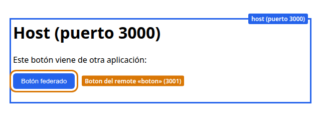

# Lab — Host y remote

[← Página anterior](00-remote-entry.md) · [Siguiente página →](02-lab-remotos-dinamicos.md)

En este laboratorio practicas la **configuración de `ModuleFederationPlugin`**. El ejercicio es mínimo: un
[remote](../glosario/02-module-federation.md#remote) tiene un componente `Boton` y un [host](../glosario/02-module-federation.md#host) quiere pintarlo. Partes de dos aplicaciones React con Webpack
que no saben nada la una de la otra y las conviertes en un remote que expone `Boton` y un host que lo
consume en tiempo de ejecución.

### Objetivo

Comprender qué es la configuración de [Module Federation](../glosario/02-module-federation.md#module-federation): qué declara el remote y qué declara el host, por
qué hace falta el [arranque asíncrono](../glosario/02-module-federation.md#arranque-asincrono), cómo se detecta que falta una pieza o que el remote está caído y cómo
se deja preparada para que el host no dependa del puerto del remote.

### Punto de partida

- Carpeta: [`ejercicios/M03-01-host-y-remote/inicio`](../../ejercicios/M03-01-host-y-remote/inicio), con
  `remote/` (puerto **3001**) y `host/` (puerto **3000**). La solución terminada está en
  [`solucion/`](../../ejercicios/M03-01-host-y-remote/solucion).
- Dependencias instaladas en la raíz del repositorio (`npm ci`, el Codespace lo hace al crearse).
- Navegador con **F12** → pestañas **Red** (Network) y **Consola** (Console).
- Si ya habías tocado `inicio/` y quieres empezar de cero ([ficha](../comandos-lab.md#reiniciar)):

```bash
# Deja inicio/ como está en el repositorio
bash scripts/reiniciar.sh M03-01-host-y-remote
```

### Qué está pasando

En un proyecto real, el remote es la aplicación de otro equipo: tiene su repositorio, su compilación y su
despliegue. El host no puede importar sus ficheros porque no los tiene; lo único que comparten es una URL.
Module Federation convierte esa URL en algo que se importa como un paquete:

| Pieza | En la realidad | En este laboratorio |
|-------|----------------|---------------------|
| Remote | La aplicación que publica un componente | `remote/`, que expone `./Boton` |
| Contenedor | El `remoteEntry.js` que publica el remote con cada despliegue | `http://localhost:3001/remoteEntry.js` |
| Host | La aplicación que lo usa | `host/`, que importa `boton/Boton` |
| Alias | El nombre con el que el host se refiere al remote | `boton` en `remotes` |

Cada aplicación declara lo suyo en su `webpack.config.js`: el remote, **qué expone** (`name`, `filename`,
`exposes`); el host, **dónde está** cada remote (`remotes`). Los dos, **qué comparten** (`shared`).

### 1 — Arranca las dos aplicaciones tal como están

Antes de federar nada, comprueba que tienes dos aplicaciones independientes que funcionan por separado
([ficha de `npm start`](../comandos-lab.md#npm-start)).

```bash
# Arranca remote (3001) y host (3000) del punto de partida
cd /workspaces/react-microfrontends-201/ejercicios/M03-01-host-y-remote/inicio
npm start
```

**Resultado esperado** (el orden de las líneas puede variar):

```text
> concurrently -n remote,host "npm start --prefix remote" "npm start --prefix host"
[host] webpack 5.112.2 compiled successfully
[host] <i> [webpack-dev-server] Loopback: http://localhost:3000/, http://[::1]:3000/
[remote] webpack 5.112.2 compiled successfully
[remote] <i> [webpack-dev-server] Loopback: http://localhost:3001/, http://[::1]:3001/
```

Abre el puerto 3000 desde la pestaña **Puertos** de VS Code (icono del globo, «Abrir en el navegador»;
fuera de Codespaces, `http://localhost:3000`) y después el 3001. Con **F12** → **Red**:

```text
Red      200  /main.js
── Texto de la página:
Host (puerto 3000)

Aquí irá el Boton que expone el remote.
```

```text
Red      200  /main.js
── Texto de la página:
Remote (puerto 3001)
Soy el botón del remote
```

Cada aplicación descarga un único `main.js` con todo dentro, React incluido. El `Boton` solo existe en el
remote.

### 2 — Importa el Boton desde el host sin Module Federation

Para ver qué resuelve el plugin, primero pide al host algo que no tiene. Sustituye el contenido de
`host/src/App.jsx`:

```jsx
// host/src/App.jsx
// 'boton/Boton' no es un fichero: Module Federation lo pide al remote «boton» en tiempo de ejecución.
import Boton from 'boton/Boton';

export default function App() {
  return (
    <main>
      <h1>Host (puerto 3000)</h1>
      <p>Este botón viene de otra aplicación:</p>
      <Boton texto="Botón federado" />
    </main>
  );
}
```

Guarda. Webpack recompila el host al momento y la terminal muestra:

**Resultado esperado** (recortado):

```text
[host] ERROR in ./src/App.jsx 2:0-32
[host] Module not found: Error: Can't resolve 'boton/Boton' in '/workspaces/react-microfrontends-201/ejercicios/M03-01-host-y-remote/inicio/host/src'
[host] resolve 'boton/Boton' in '/workspaces/react-microfrontends-201/ejercicios/M03-01-host-y-remote/inicio/host/src'
[host]   Parsed request is a module
```

Y, unas líneas más abajo, el resumen de la compilación:

```text
[host] webpack 5.112.2 compiled with 1 error
```

`Parsed request is a module`: Webpack trata `boton/Boton` como un paquete de `node_modules` y no lo
encuentra. Falta decirle que `boton` es un remote. Deja el `App.jsx` así; lo arreglas en los pasos
siguientes.

### 3 — Convierte el remote en contenedor

El remote tiene que publicar un `remoteEntry.js` que diga qué expone. Edita `remote/webpack.config.js`:
añade el `require` al principio y el plugin delante de `HtmlWebpackPlugin`.

```js
// remote/webpack.config.js — al principio del fichero
const HtmlWebpackPlugin = require('html-webpack-plugin');
const { ModuleFederationPlugin } = require('webpack').container;   // viene con Webpack 5
```

```js
// remote/webpack.config.js — en plugins
  plugins: [
    new ModuleFederationPlugin({
      name: 'boton',                       // nombre del contenedor
      filename: 'remoteEntry.js',          // fichero de entrada que pedirá el host
      exposes: { './Boton': './src/Boton.jsx' },
      shared: { react: { singleton: true }, 'react-dom': { singleton: true } },
    }),
    new HtmlWebpackPlugin({ template: './public/index.html', publicPath: '/' }),
  ],
```

| Opción | Qué decide |
|--------|-----------|
| `name` | El nombre global del contenedor (`window.boton`); el host lo escribirá delante de la `@` |
| `filename` | Cómo se llama el fichero de entrada que sirve el remote |
| `exposes` | Nombre público (`./Boton`) → fichero real. Lo que no está aquí no se puede pedir desde fuera |
| `shared` | Dependencias que el remote no quiere duplicar (se trabaja en [03 — Dependencias compartidas](03-lab-dependencias-compartidas.md)) |

### 4 — Dale al remote un arranque asíncrono

Con `shared`, React ya no está dentro de `main.js` desde el principio: hay que esperar a saber qué copia se
usa. Mueve el arranque a otro fichero y deja en `index.js` solo la importación dinámica.

1. Renombra `remote/src/index.js` a `remote/src/bootstrap.js` (su contenido no cambia):

```jsx
// remote/src/bootstrap.js
import { createRoot } from 'react-dom/client';
import App from './App';

createRoot(document.getElementById('root')).render(<App />);
```

2. Crea un `remote/src/index.js` nuevo con una sola línea:

```js
// remote/src/index.js
// Arranque asíncrono: da tiempo a Module Federation a resolver remotes y dependencias compartidas.
import('./bootstrap');
```

`import()` convierte `bootstrap.js` en un trozo aparte. Mientras se descarga, Module Federation prepara las
[dependencias compartidas](../glosario/02-module-federation.md#shared); cuando `bootstrap.js` hace su primer `import` de React, ya están listas.

### 5 — Dile al host dónde está el remote

Ahora el host necesita saber que `boton` es un remote y dónde está su `remoteEntry.js`. Edita
`host/webpack.config.js` igual que el del remote: el `require` arriba y el plugin en `plugins`.

```js
// host/webpack.config.js — al principio del fichero
const HtmlWebpackPlugin = require('html-webpack-plugin');
const { ModuleFederationPlugin } = require('webpack').container;
```

```js
// host/webpack.config.js — en plugins
  plugins: [
    new ModuleFederationPlugin({
      name: 'host',
      remotes: { boton: 'boton@/mf/boton/remoteEntry.js' },   // alias@URL del remoteEntry.js
      shared: { react: { singleton: true }, 'react-dom': { singleton: true } },
    }),
    new HtmlWebpackPlugin({ template: './public/index.html', publicPath: '/' }),
  ],
```

La clave `boton` es el alias que usa el `import` (`boton/Boton`). El valor tiene dos partes: antes de la
`@`, el `name` del contenedor (`window.boton`); después, la URL de su `remoteEntry.js`.

> [!NOTE]
> **La URL es `/mf/boton/…`, no `localhost:3001`.** En este curso el navegador solo habla con el host: los
> remotes se piden en su mismo origen, bajo `/mf/<nombre>/`, y el servidor del host los reenvía al puerto
> de cada remote. Ese reenvío ya está en el `devServer` del host del punto de partida:
>
> ```js
> // host/webpack.config.js — devServer (ya estaba)
> proxy: [
>   // /mf/boton/remoteEntry.js → http://localhost:3001/remoteEntry.js
>   { context: ['/mf/boton'], target: 'http://localhost:3001', pathRewrite: { '^/mf/boton': '' } },
> ],
> ```
>
> En Codespaces cada puerto es otro dominio y en producción todo cuelga de uno: con la ruta relativa, el
> host funciona igual en los dos. En Docker y Kubernetes (M07) el reenvío lo hace nginx.

### 6 — Dale al host el mismo arranque asíncrono

El host también comparte React, así que necesita el mismo arranque. Repite el paso 4 en `host/src/`:
renombra `index.js` a `bootstrap.js` y crea un `index.js` nuevo.

```jsx
// host/src/bootstrap.js (el antiguo index.js, sin cambios)
import { createRoot } from 'react-dom/client';
import App from './App';

createRoot(document.getElementById('root')).render(<App />);
```

```js
// host/src/index.js
// Arranque asíncrono: da tiempo a Module Federation a resolver remotes y dependencias compartidas.
import('./bootstrap');
```

En el host la espera tiene un motivo más: `App.jsx` importa `boton/Boton`, que solo existe cuando ha
llegado `remoteEntry.js`.

### 7 — Reinicia y mira el Boton en el host

Webpack no relee `webpack.config.js` en caliente: para que cojan el plugin, para las dos aplicaciones y
vuelve a arrancarlas.

```bash
# Ctrl+C para parar; después, en la misma carpeta:
npm start
```

**Resultado esperado** (el orden de las líneas puede variar):

```text
> concurrently -n remote,host "npm start --prefix remote" "npm start --prefix host"
[host] webpack 5.112.2 compiled successfully
[host] <i> [webpack-dev-server] Loopback: http://localhost:3000/, http://[::1]:3000/
[remote] webpack 5.112.2 compiled successfully
[remote] <i> [webpack-dev-server] Loopback: http://localhost:3001/, http://[::1]:3001/
```

Recarga el host (puerto 3000) con **F12** → **Red** abierto y pulsa el botón:

```text
Red      200  /main.js
Red      200  /src_bootstrap_js-webpack_sharing_consume_default_react-dom_react-dom-webpack_sharing_consume_-f8f6f9.js
Red      200  /mf/boton/remoteEntry.js
Red      200  /vendors-node_modules_react-dom_client_js-node_modules_react_jsx-dev-runtime_js.js
Red      200  /mf/boton/vendors-node_modules_react_index_js.js
Red      200  /mf/boton/src_Boton_jsx.js
Red      200  /mf/boton/vendors-node_modules_react_jsx-dev-runtime_js.js
Red      200  /mf/boton/vendors-node_modules_react-dom_index_js.js
── Clic
Consola  clic en el Boton del remote
── Texto de la página:
Host (puerto 3000)

Este botón viene de otra aplicación:

Botón federado
```



| Qué ves | Qué significa |
|---------|---------------|
| `main.js` y luego `src_bootstrap_js-…` | El arranque asíncrono: `main.js` solo pide `bootstrap.js` |
| `/mf/boton/remoteEntry.js` | El host pide el contenedor en su mismo origen; el proxy lo trae del 3001 |
| `/mf/boton/src_Boton_jsx.js` | El código del `Boton`, compilado por el remote |
| `/mf/boton/vendors-node_modules_react_index_js.js` | React, una sola copia para las dos aplicaciones |
| «Botón federado» | La prop `texto` la pone el host; el componente es del remote |
| `clic en el Boton del remote` en la **Consola** | El `onClick` del remote se ejecuta dentro de la página del host |

### 8 — Comprueba el reenvío del host

El host sirve el contenedor del remote como si fuera suyo. Primero míralo en crudo: abre en el navegador
el puerto 3000 con `/mf/boton/remoteEntry.js` al final de la dirección. Verás el mismo fichero que sirve el
remote en el 3001, empezando por `var boton;`. Después, las cabeceras desde la terminal:

```bash
# En otra terminal: cabeceras del remoteEntry.js pedido al host (puerto 3000)
curl -sI http://localhost:3000/mf/boton/remoteEntry.js | head -5
```

**Resultado esperado:**

```text
HTTP/1.1 200 OK
x-powered-by: Express
access-control-allow-origin: *
accept-ranges: bytes
content-type: text/javascript; charset=utf-8
```

Un `200` con `content-type: text/javascript` en el puerto del host: el navegador nunca ha tenido que
hablar con el 3001.

## Comprueba tu entendimiento

**El remote sigue siendo una aplicación**
Abre el puerto 3001 en el navegador.
→ Ves «Remote (puerto 3001)» y «Soy el botón del remote»: el remote se desarrolla y se prueba solo, y en la
pestaña **Red** aparece también su propio `remoteEntry.js`.

**El alias es el del host**
Mira el `import` de `host/src/App.jsx` y la clave de `remotes` en `host/webpack.config.js`.
→ Las dos dicen `boton`. La parte `./Boton` del `import` corresponde a la clave de `exposes` del remote.

**Lo que no se expone no existe**
En la **Consola** del host, pide al contenedor un módulo que no está en `exposes`:

```js
// En la Consola del host (puerto 3000)
window.boton.get('./App')
```

→ La promesa se rechaza con `Module "./App" does not exist in container.`, el mismo mensaje que se ve
dentro de `remoteEntry.js`.

## Investiga

¿Qué trozos pide el host para el `Boton` y por qué esos? Abre `http://localhost:3001/remoteEntry.js` en el
navegador (puerto 3001, `/remoteEntry.js`) y busca con `Ctrl+F` el texto `"./Boton"`. Debajo está la lista
de trozos que el contenedor descarga para ese módulo. Compárala con las peticiones `/mf/boton/…` de la
pestaña **Red** del host. Cuando ya sepas qué buscar, este filtro te lleva al mismo sitio:

```bash
# El mapa de módulos expuestos del contenedor «boton»
curl -s http://localhost:3001/remoteEntry.js | grep -n -A4 "const moduleMap"
```

**Resultado esperado** (el sufijo `_7a22` puede cambiar en tu entorno):

```text
12:const moduleMap = {
13-	"./Boton": () => {
14-		return Promise.all([__webpack_require__.e("vendors-node_modules_react_jsx-dev-runtime_js"), __webpack_require__.e("webpack_sharing_consume_default_react_react-_7a22"), __webpack_require__.e("src_Boton_jsx")]).then(() => (() => ((__webpack_require__(/*! ./src/Boton.jsx */ "./src/Boton.jsx")))));
15-	}
16-};
```

Tres trozos: el runtime de JSX, la consulta de React compartido y el código del `Boton`. React y React DOM no
están en la lista: llegan por `shared`, y por eso en la pestaña **Red** se ven aparte.

## Experimenta

**Predice antes:** si el remote se cae y alguien recarga el host, ¿se ve la página del host sin el botón,
o no se ve nada?

Para solo el remote, dejando el host en marcha:

```bash
# En otra terminal: mata el servidor del remote (puerto 3001)
fuser -k 3001/tcp
```

Recarga el host con **F12** abierto.

**Resultado esperado:**

```text
Red      200  /main.js
Consola (error)  Failed to load resource: the server responded with a status of 504 (Gateway Timeout)
Red      falló  http://localhost:3000/mf/boton/remoteEntry.js
Consola (aviso)  Initialization of sharing external failed: ScriptExternalLoadError: Loading script failed.
(error: http://localhost:3000/mf/boton/remoteEntry.js)
Red      200  /src_bootstrap_js-webpack_sharing_consume_default_react-dom_react-dom-webpack_sharing_consume_-f8f6f9.js
Red      200  /vendors-node_modules_react_index_js.js
Red      200  /vendors-node_modules_react-dom_index_js.js
Red      200  /vendors-node_modules_react-dom_client_js-node_modules_react_jsx-dev-runtime_js.js
Consola (error)  Uncaught ScriptExternalLoadError: Loading script failed.
── Texto de la página:

```

**Cómo se lee:**

| Línea | Qué ha pasado |
|-------|---------------|
| `504 (Gateway Timeout)` en `/mf/boton/remoteEntry.js` | El proxy del host no encuentra a nadie en el 3001 |
| `Initialization of sharing external failed` | Aviso: el host no puede contar con el remote para las dependencias compartidas |
| `/vendors-node_modules_react_index_js.js` sin `/mf/boton/` | El host usa su propia copia de React (el `fallback` de `shared`) |
| `ScriptExternalLoadError` y la página en blanco | `App.jsx` importa `boton/Boton` de forma estática: sin contenedor, `bootstrap.js` falla y no se pinta nada |

Un remote caído tumba la página entera porque el host lo importa de forma estática. En
[04 — Lazy loading de remotos](04-lab-lazy-loading-remotos.md) se carga cada remote bajo demanda y con una [barrera de errores](../glosario/02-module-federation.md#barrera-de-errores)
para que su fallo quede aislado. Vuelve a arrancar todo con `Ctrl+C` y `npm start` en `inicio/`.

## Reto

### 1 — Un alias distinto del nombre del contenedor

**La situación:** en el host ya hay una carpeta propia que se llama `boton`, y un compañero propone que el
remote se importe como `ui/Boton` para que no se confunda. El remote no quiere cambiar su `name`: otros
hosts ya lo usan como `boton`.

**Qué haces:** cambia solo el host para que el `import` sea `ui/Boton`, sin tocar el `webpack.config.js`
del remote. Reinicia con `npm start` y recarga el host.

**Pistas:** en `remotes`, la clave y la parte de delante de la `@` no tienen por qué coincidir. Una es
del host y la otra es del remote.

**Lo que buscas:** el host pinta «Botón federado» con `import Boton from 'ui/Boton'`, y en la pestaña
**Red** la petición sigue siendo `/mf/boton/remoteEntry.js`.

<details>
<summary>Ver solución</summary>

```js
// host/webpack.config.js — la clave es el alias del host; «boton@» es el name del remote
remotes: { ui: 'boton@/mf/boton/remoteEntry.js' },
```

```jsx
// host/src/App.jsx — el import usa el alias, no el nombre del contenedor
import Boton from 'ui/Boton';
```

La página es la misma de antes: el alias solo existe en la compilación del host. Si cambias la parte de
delante de la `@` (`otro@/mf/boton/remoteEntry.js`), el host descarga el `remoteEntry.js` pero busca
`window.otro`, que no existe, y la carga falla.

**La regla:** la clave de `remotes` es del host (cómo lo importa); el `name@` y la URL son del remote
(cómo se llama su contenedor y dónde está). Solo los segundos tienen que coincidir con el remote.

</details>

## Errores frecuentes

| Síntoma | Causa probable | Cómo arreglarlo |
|---------|----------------|-----------------|
| `Module not found: Error: Can't resolve 'boton/Boton'` al compilar | El host no tiene `ModuleFederationPlugin` o la clave de `remotes` no coincide con el `import` | Añade `remotes: { boton: 'boton@/mf/boton/remoteEntry.js' }` y reinicia con `npm start` |
| Has cambiado `webpack.config.js` y no pasa nada | El servidor de desarrollo no relee su configuración en caliente | `Ctrl+C` y `npm start` en la carpeta del ejercicio |
| `Shared module is not available for eager consumption` en la **Consola** | Falta el arranque asíncrono: `index.js` importa React directamente | Mueve el arranque a `bootstrap.js` y deja en `index.js` solo `import('./bootstrap')` |
| `504 (Gateway Timeout)` en `/mf/boton/remoteEntry.js` | El remote no está en marcha en el 3001 | Arráncalo: `npm start` en `inicio/` (arranca los dos) |
| `404` en `/mf/boton/remoteEntry.js` | Falta la regla `/mf/boton` en `devServer.proxy` del host, o el remote no tiene `filename: 'remoteEntry.js'` | Revisa los dos `webpack.config.js` y reinicia |
| `Module "./Boton" does not exist in container.` | La clave de `exposes` del remote no es `./Boton` | Haz que `exposes` y la parte de después de `boton/` en el `import` coincidan |
| `Error: listen EADDRINUSE: address already in use :::3000` | Hay otro ejercicio en marcha | Páralo con `Ctrl+C` o libera los puertos con el bloque de la [ficha de `npm start`](../comandos-lab.md#npm-start) |

Para liberar los puertos desde la terminal:

```bash
# Mata lo que esté escuchando en los puertos de los ejercicios
fuser -k 3000/tcp 3001/tcp 3002/tcp 3003/tcp
```

## Conclusiones

### Qué es la configuración de Module Federation

Un [contrato](../glosario/01-arquitectura.md#contrato) entre dos `webpack.config.js`. El remote dice qué ofrece y cómo se llama su contenedor; el
host dice con qué alias lo importa y en qué URL está. Lo que los une en tiempo de ejecución es el
`remoteEntry.js`.

```text
host/App.jsx                    host/webpack.config.js               remote/webpack.config.js
import 'boton/Boton'  ──►  remotes: { boton: 'boton@/mf/boton/remoteEntry.js' }
                                       │       │                        name: 'boton'
                                       │       └── GET /mf/boton/remoteEntry.js ─(proxy)─► :3001
                                       └── window.boton.get('./Boton') ──► exposes: { './Boton': … }
```

### Cómo debe ser

| Requisito | En el lab |
|-----------|-----------|
| El remote declara `name`, `filename` y `exposes` | `boton`, `remoteEntry.js`, `./Boton` |
| El host declara `remotes` con `alias: 'name@URL'` | `boton: 'boton@/mf/boton/remoteEntry.js'` |
| Los dos comparten React | `shared: { react: { singleton: true }, 'react-dom': { singleton: true } }` |
| Arranque asíncrono en los dos | `index.js` → `import('./bootstrap')` |
| El remote se pide en el origen del host | `/mf/boton/` y `devServer.proxy` hacia el 3001 |

### Dónde se rompe y cómo lo has detectado

| Fallo | Cómo lo has visto | Qué provoca |
|-------|-------------------|-------------|
| El host no sabe que `boton` es un remote | `Module not found … Parsed request is a module` en la terminal | El host no compila |
| El remote está caído | `504`, `ScriptExternalLoadError` en la **Consola** | La página del host en blanco |
| Se pide un módulo no expuesto | `Module "./App" does not exist in container.` | La carga de ese módulo falla |

### Cómo se perfecciona

- La URL del remote no se deja escrita en el código compilado del host: se lee al arrancar
  ([02 — Remotos dinámicos](02-lab-remotos-dinamicos.md)).
- Se fija qué versión de React acepta cada uno ([03 — Dependencias compartidas](03-lab-dependencias-compartidas.md)).
- El remote se carga cuando se necesita y su fallo queda aislado
  ([04 — Lazy loading de remotos](04-lab-lazy-loading-remotos.md)).
- En equipos grandes, los nombres expuestos (`./Boton`) se tratan como una API pública: cambiarlos rompe a
  todos los hosts.

### En una frase

> 🔑 El remote dice qué expone y cómo se llama; el host dice con qué alias lo importa y dónde está su `remoteEntry.js`; el arranque asíncrono da tiempo a que todo llegue antes de pintar.
