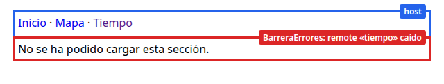

# Lab — Lazy loading de remotos

[← Página anterior](03-lab-dependencias-compartidas.md) · [Siguiente página →](../M04-state-management/README.md)

En este laboratorio practicas **`React.lazy`, `Suspense` y la [barrera de errores](../glosario/02-module-federation.md#barrera-de-errores)** aplicados a [remotes](../glosario/02-module-federation.md#remote). El
ejercicio es un [host](../glosario/02-module-federation.md#host) con tres rutas, Inicio, Mapa y Tiempo; Mapa y Tiempo las pintan dos remotes. Con
imports estáticos, el código de los dos llega al abrir Inicio. Lo cambias para que cada uno llegue al
entrar en su ruta y para que, si un remote está caído, solo falle su sección.

### Objetivo

Comprender qué es la carga diferida ([lazy loading](../glosario/02-module-federation.md#lazy-loading)) de un remote: qué se retrasa de verdad y qué no, cómo se mide en la
pestaña **Red**, por qué un remote que no carga necesita su barrera de errores y cómo se retrasa también su
`remoteEntry.js`.

### Punto de partida

- Carpeta: [`ejercicios/M03-04-lazy-loading-remotos/inicio`](../../ejercicios/M03-04-lazy-loading-remotos/inicio),
  con `mapa/` (puerto **3001**, expone `./Mapa`), `tiempo/` (puerto **3002**, expone `./Tiempo`) y `host/`
  (puerto **3000**, con React Router). La solución está en
  [`solucion/`](../../ejercicios/M03-04-lazy-loading-remotos/solucion).
- Los tres ya están federados, comparten React como [singleton](../glosario/02-module-federation.md#singleton) y tienen [arranque asíncrono](../glosario/02-module-federation.md#arranque-asincrono). El host importa
  `mapa/Mapa` y `tiempo/Tiempo` de forma estática.
- Navegador con **F12** → pestañas **Red** (Network) y **Consola** (Console).
- Para empezar de cero ([ficha](../comandos-lab.md#reiniciar)):

```bash
# Deja inicio/ como está en el repositorio
bash scripts/reiniciar.sh M03-04-lazy-loading-remotos
```

### Qué está pasando

Una página compuesta de [microfrontends](../glosario/01-arquitectura.md#microfrontend) crece con cada equipo que añade el suyo. Si el host importa todos
los remotes de forma estática, el usuario que solo visita Inicio descarga el código de todos, y un solo
remote caído deja la página en blanco. En un proyecto real cada sección se carga al entrar en ella y su
fallo se queda en ella.

| En la realidad | En este laboratorio |
|----------------|---------------------|
| Secciones de una aplicación que publican equipos distintos | Rutas `/mapa` y `/tiempo` |
| La sección que nadie visita no debería costar nada | El código de `Mapa` no llega hasta pulsar **Mapa** |
| Un microfrontend caído | El remote `tiempo` parado |
| El resto de la aplicación sigue en pie | **Mapa** funciona aunque **Tiempo** falle |

Tres piezas de React lo resuelven:

| Pieza | Qué hace |
|-------|----------|
| `lazy(() => import('mapa/Mapa'))` | Convierte el `import` en una promesa que se lanza la primera vez que se pinta el componente |
| `<Suspense fallback={…}>` | Pinta el `fallback` mientras la promesa no se resuelve |
| Barrera de errores (*error boundary*) | Un componente de clase que captura el error de sus hijos (también una promesa de `lazy` rechazada) y pinta otra cosa |

### 1 — Arranca el punto de partida y mide qué se descarga

Arranca las tres aplicaciones ([ficha de `npm start`](../comandos-lab.md#npm-start)).

```bash
# Arranca mapa (3001), tiempo (3002) y host (3000)
cd /workspaces/react-microfrontends-201/ejercicios/M03-04-lazy-loading-remotos/inicio
npm start
```

**Resultado esperado** (el orden de las líneas puede variar):

```text
> concurrently -n mapa,tiempo,host "npm start --prefix mapa" "npm start --prefix tiempo" "npm start --prefix host"
[tiempo] webpack 5.112.2 compiled successfully
[tiempo] <i> [webpack-dev-server] Loopback: http://localhost:3002/, http://[::1]:3002/
[mapa] webpack 5.112.2 compiled successfully
[mapa] <i> [webpack-dev-server] Loopback: http://localhost:3001/, http://[::1]:3001/
[host] webpack 5.112.2 compiled successfully
[host] <i> [webpack-dev-server] Loopback: http://localhost:3000/, http://[::1]:3000/
```

Abre el host (puerto 3000, pestaña **Puertos**, icono del globo) con **F12** → **Red** abierto. Estás en
Inicio. Después pulsa **Mapa**:

```text
Red      200  /main.js
Red      200  /src_bootstrap_js-webpack_sharing_consume_default_react-dom_react-dom-webpack_sharing_consume_-bc806b.js
Red      200  /mf/mapa/remoteEntry.js
Red      200  /mf/tiempo/remoteEntry.js
Red      200  /mf/tiempo/vendors-node_modules_react_index_js.js
Red      200  /mf/mapa/vendors-node_modules_react_jsx-dev-runtime_js.js
Red      200  /mf/mapa/src_Mapa_jsx.js
Red      200  /mf/tiempo/vendors-node_modules_react_jsx-dev-runtime_js.js
Red      200  /vendors-node_modules_react-dom_client_js-node_modules_react_jsx-dev-runtime_js-node_modules_r-094e60.js
Red      200  /mf/tiempo/vendors-node_modules_react-dom_index_js.js
Red      200  /mf/tiempo/src_Tiempo_jsx.js
── Clic
── Texto de la página:
Inicio · Mapa · Tiempo
Mapa

Mapa: estás en Madrid (40.41, -3.70).
```

Todo lo que está por encima de `── Clic` se ha descargado **en Inicio**, antes de pulsar nada:
`src_Mapa_jsx.js` y `src_Tiempo_jsx.js` incluidos. El clic en **Mapa** no pide nada nuevo. Es lo que dice
el comentario de `host/src/App.jsx`:

```jsx
// host/src/App.jsx (punto de partida)
// Imports estáticos: los dos remotes se descargan al abrir la página, aunque no se visiten.
import Mapa from 'mapa/Mapa';
import Tiempo from 'tiempo/Tiempo';
```

### 2 — Crea la barrera de errores

Antes de diferir la carga, prepara dónde caerá un fallo. Una barrera de errores tiene que ser un
componente de clase: React no ofrece un hook equivalente. Crea `host/src/BarreraErrores.jsx`:

```jsx
// host/src/BarreraErrores.jsx
import { Component } from 'react';

// Barrera de errores: si un remote no carga, se muestra un aviso y el resto de la página sigue.
export default class BarreraErrores extends Component {
  state = { error: null };

  static getDerivedStateFromError(error) {
    return { error };             // guarda el error: el siguiente render pinta el aviso
  }

  render() {
    if (this.state.error) return <p role="alert">No se ha podido cargar esta sección.</p>;
    return this.props.children;
  }
}
```

Una vez que guarda un error, la barrera lo conserva hasta que React la desmonta. Eso importa en el paso 3.

### 3 — Carga cada remote con lazy y envuélvelo

Sustituye `host/src/App.jsx`. Los `import` estáticos pasan a `lazy`, y cada ruta remota va dentro de una
`Seccion` con su barrera y su `Suspense`.

```jsx
// host/src/App.jsx
import { lazy, Suspense } from 'react';
import { Link, Route, Routes } from 'react-router';
import BarreraErrores from './BarreraErrores';

// lazy: el remote se pide la primera vez que se pinta su ruta.
const Mapa = lazy(() => import('mapa/Mapa'));
const Tiempo = lazy(() => import('tiempo/Tiempo'));

// Cada ruta tiene su propia barrera (key distinta): el fallo de una no se arrastra a otra.
function Seccion({ children }) {
  return (
    <BarreraErrores>
      <Suspense fallback={<p>Cargando…</p>}>{children}</Suspense>
    </BarreraErrores>
  );
}

export default function App() {
  return (
    <main>
      <nav><Link to="/">Inicio</Link> · <Link to="/mapa">Mapa</Link> · <Link to="/tiempo">Tiempo</Link></nav>
      <Routes>
        <Route path="/" element={<h1>Inicio</h1>} />
        <Route path="/mapa" element={<Seccion key="mapa"><Mapa /></Seccion>} />
        <Route path="/tiempo" element={<Seccion key="tiempo"><Tiempo /></Seccion>} />
      </Routes>
    </main>
  );
}
```

| Pieza | Por qué está ahí |
|-------|------------------|
| `import('mapa/Mapa')` dentro de `lazy` | Mismo alias que antes; ahora es una importación dinámica que solo se lanza al pintar `<Mapa />` |
| `Suspense` dentro de la barrera | Mientras llega el código, `Cargando…`; si la promesa falla, el error sube hasta la barrera |
| `key="mapa"` y `key="tiempo"` | Las dos rutas pintan el mismo tipo de componente (`Seccion`) en el mismo sitio. Sin `key`, React reutilizaría la misma barrera al cambiar de ruta, con el error guardado dentro |

No has tocado ningún `webpack.config.js`: al guardar, Webpack recompila el host y no hace falta reiniciar.

### 4 — Mide otra vez qué se descarga y cuándo

Recarga el host en Inicio con la pestaña **Red** limpia (icono de borrar). Pulsa **Mapa** y después
**Tiempo**.

**Resultado esperado:**

```text
Red      200  /main.js
Red      200  /src_bootstrap_js-webpack_sharing_consume_default_react-dom_react-dom-webpack_sharing_consume_-bc806b.js
Red      200  /mf/tiempo/remoteEntry.js
Red      200  /mf/mapa/remoteEntry.js
Red      200  /mf/tiempo/vendors-node_modules_react-dom_index_js.js
Red      200  /mf/tiempo/vendors-node_modules_react_index_js.js
Red      200  /vendors-node_modules_react-dom_client_js-node_modules_react_jsx-dev-runtime_js-node_modules_r-094e60.js
── Clic
Red      200  /mf/mapa/vendors-node_modules_react_jsx-dev-runtime_js.js
Red      200  /mf/mapa/src_Mapa_jsx.js
── Clic
Red      200  /mf/tiempo/src_Tiempo_jsx.js
Red      200  /mf/tiempo/vendors-node_modules_react_jsx-dev-runtime_js.js
── Texto de la página:
Inicio · Mapa · Tiempo
Tiempo

Tiempo: 18 °C y despejado.
```

**Cómo se lee:**

| Momento | Qué se descarga |
|---------|-----------------|
| Al abrir Inicio | `main.js`, el arranque, **los dos `remoteEntry.js`** y React (una copia, compartida) |
| Al pulsar **Mapa** | Solo `src_Mapa_jsx.js` y su JSX runtime |
| Al pulsar **Tiempo** | Solo `src_Tiempo_jsx.js` y su JSX runtime |

Lo que se retrasa es el **código del módulo expuesto**. Los `remoteEntry.js` siguen llegando al
arrancar, y no es un error del lab:

> [!NOTE]
> **Por qué los `remoteEntry.js` se descargan igual.** Los remotes siguen declarados en `remotes` del
> `webpack.config.js` del host. Antes de ejecutar `bootstrap.js`, el host inicializa el share scope para
> decidir qué copia de React se usa, y cada remote declarado puede ofrecer la suya: para preguntárselo,
> Webpack descarga su `remoteEntry.js` y llama a `init`. Por eso React llega aquí desde
> `/mf/tiempo/…`: lo ha ofrecido uno de los remotes. `lazy` retrasa solo el `get('./Mapa')`, es decir,
> `src_Mapa_jsx.js`. El `remoteEntry.js` es pequeño (un índice), así que casi siempre basta. Para retrasar
> también el `remoteEntry.js`, el remote tiene que salir de `remotes` y cargarse a mano, con la técnica de
> [02 — Remotos dinámicos](02-lab-remotos-dinamicos.md): es el reto de esta página.

### 5 — Para un remote y comprueba que solo falla su sección

Ahora la prueba de fuego: con el remote `tiempo` caído, Inicio y Mapa tienen que seguir funcionando.

```bash
# En otra terminal: mata el servidor del remote tiempo (puerto 3002)
fuser -k 3002/tcp
```

Recarga el host en Inicio, pulsa **Tiempo** y después **Mapa**.

**Resultado esperado:**

```text
Red      200  /main.js
Consola (error)  Failed to load resource: the server responded with a status of 504 (Gateway Timeout)
Red      falló  http://localhost:3000/mf/tiempo/remoteEntry.js
Consola (aviso)  Initialization of sharing external failed: ScriptExternalLoadError: Loading script failed.
(error: http://localhost:3000/mf/tiempo/remoteEntry.js)
Red      200  /src_bootstrap_js-webpack_sharing_consume_default_react-dom_react-dom-webpack_sharing_consume_-bc806b.js
Red      200  /mf/mapa/remoteEntry.js
Red      200  /mf/mapa/vendors-node_modules_react-dom_index_js.js
Red      200  /mf/mapa/vendors-node_modules_react_index_js.js
Red      200  /vendors-node_modules_react-dom_client_js-node_modules_react_jsx-dev-runtime_js-node_modules_r-094e60.js
── Clic
Consola (error)  %o

%s

%s
 ScriptExternalLoadError: Loading script failed. The above error occurred in one of your React components. React will try to recreate this component tree from scratch using the error boundary you provided, BarreraErrores.
── Clic
Red      200  /mf/mapa/src_Mapa_jsx.js
Red      200  /mf/mapa/vendors-node_modules_react_jsx-dev-runtime_js.js
── Texto de la página:
Inicio · Mapa · Tiempo
Mapa

Mapa: estás en Madrid (40.41, -3.70).
```

Antes de pulsar **Mapa**, con **Tiempo** en pantalla, la barrera de esa ruta ha recogido el fallo y el resto del
host sigue en pie:



**Cómo se lee:**

| Línea | Qué ha pasado |
|-------|---------------|
| `504` en `/mf/tiempo/remoteEntry.js` y `Initialization of sharing external failed` | Al arrancar, el host no consigue el contenedor de `tiempo`. Es un aviso: el arranque sigue y React llega ahora de `/mf/mapa/` |
| Inicio se pinta | Ningún componente de Inicio necesita a `tiempo` |
| Al pulsar **Tiempo**: `ScriptExternalLoadError … using the error boundary you provided, BarreraErrores` | `lazy` falla y el error lo captura la barrera de esa ruta; en pantalla, «No se ha podido cargar esta sección.» |
| Al pulsar **Mapa**: `src_Mapa_jsx.js` y el texto de Mapa | La ruta Mapa tiene otra barrera (otra `key`), limpia, y carga su remote con normalidad |

Compáralo con el host de [01 — Host y remote](01-lab-host-y-remote.md) con su remote parado: allí el
`import` estático hacía fallar `bootstrap.js` y la página quedaba en blanco. Vuelve a arrancar todo con
`Ctrl+C` y `npm start` en `inicio/`.

## Comprueba tu entendimiento

**Inicio no cuesta código de remotes**
Recarga en Inicio y escribe `src_` en el filtro de la pestaña **Red**.
→ No aparecen `src_Mapa_jsx.js` ni `src_Tiempo_jsx.js`. Aparecen al pulsar su ruta, y solo la primera vez:
volver a **Mapa** no repite la descarga.

**El aviso de carga**
En la pestaña **Red**, abre el desplegable de limitación de red (Throttling), elige un perfil lento (por ejemplo,
**3G**), recarga en Inicio y pulsa **Mapa**.
→ Durante un momento se ve `Cargando…`, el `fallback` del `Suspense`, antes del texto de Mapa. Quita después
la limitación (**No throttling**).

## Investiga

¿Quién pide cada `remoteEntry.js`? En la pestaña **Red**, pulsa sobre `/mf/mapa/remoteEntry.js` y mira la
columna **Iniciador** (Initiator): ¿qué fichero la lanza, y lo hace antes o después de `bootstrap.js`? Haz lo
mismo con `/mf/mapa/src_Mapa_jsx.js` y compara: el primero lo pide el runtime de Webpack al arrancar; el
segundo, la cadena que empieza en el `lazy` de tu `App.jsx`. Con eso tienes la [frontera](../glosario/01-arquitectura.md#frontera) exacta entre lo que inicializa
[Module Federation](../glosario/02-module-federation.md#module-federation) al arrancar y lo que retrasa React.

## Experimenta

**Predice antes:** si quitas las `key` de las dos `Seccion`, con el remote `tiempo` parado, y pulsas
**Tiempo** y luego **Mapa**, ¿verás el mapa o el aviso de error?

Quita `key="mapa"` y `key="tiempo"` de `host/src/App.jsx`, guarda, para el remote `tiempo` como en el
paso 5, recarga en Inicio y pulsa **Tiempo** y después **Mapa**.

**Resultado esperado** (recortado tras el clic en **Tiempo**):

```text
Red      200  /main.js
Consola (error)  Failed to load resource: the server responded with a status of 504 (Gateway Timeout)
Red      falló  http://localhost:3000/mf/tiempo/remoteEntry.js
…
── Clic
Consola (error)  %o
%s
%s
 ScriptExternalLoadError: Loading script failed. … using the error boundary you provided, BarreraErrores.
── Clic
── Texto de la página:
Inicio · Mapa · Tiempo

No se ha podido cargar esta sección.
```

**Qué observar:** en **Mapa** sigue el aviso «No se ha podido cargar esta sección.» y, tras el segundo clic,
la pestaña **Red** no pide `src_Mapa_jsx.js`. Las dos rutas pintan una `Seccion` en la misma posición del árbol: sin `key`,
React no desmonta la barrera al cambiar de ruta, solo le cambia los hijos, y la barrera conserva el error
de Tiempo. Con una `key` distinta por ruta, cada una tiene su propia barrera. Vuelve a poner las `key` y
arranca todo de nuevo.

## Reto

### 1 — Retrasar también el remoteEntry.js de tiempo

**La situación:** la sección Tiempo la visita poca gente, y su equipo propone que su remote no cueste
nada, ni siquiera el `remoteEntry.js`, hasta que alguien pulse **Tiempo**. Mapa puede seguir como está.

**Qué haces:** quita `tiempo` de `remotes` en `host/webpack.config.js` y carga el remote a mano con la
función `cargarModulo` del lab de remotos dinámicos. Copia ese fichero en `host/src/cargarRemoto.js`
(está en
[`ejercicios/M03-02-remotos-dinamicos/solucion/host/src/cargarRemoto.js`](../../ejercicios/M03-02-remotos-dinamicos/solucion/host/src/cargarRemoto.js)).
Reinicia con `npm start` y mide con la pestaña **Red** como en el paso 4.

**Pistas:** `lazy` acepta cualquier función que devuelva una promesa de módulo; `cargarModulo(nombre, url,
modulo)` devuelve exactamente eso. El `name` del remote es `tiempo` y su módulo, `./Tiempo`. El proxy
`/mf/tiempo` del `devServer` sigue haciendo falta.

**Lo que buscas:** al abrir Inicio, `/mf/tiempo/remoteEntry.js` ya no aparece en la pestaña **Red**; aparece,
junto con `src_Tiempo_jsx.js`, al pulsar **Tiempo**. La barrera sigue funcionando si paras el remote.

<details>
<summary>Ver solución</summary>

```js
// host/webpack.config.js — en plugins: solo mapa queda declarado
      remotes: {
        mapa: 'mapa@/mf/mapa/remoteEntry.js',
      },
```

```jsx
// host/src/App.jsx — tiempo se carga a mano: su remoteEntry.js llega al pulsar la ruta
import { cargarModulo } from './cargarRemoto';

const Mapa = lazy(() => import('mapa/Mapa'));
const Tiempo = lazy(() => cargarModulo('tiempo', '/mf/tiempo/remoteEntry.js', './Tiempo'));
```

Al abrir Inicio solo se descarga `/mf/mapa/remoteEntry.js`. Al pulsar **Tiempo**, `cargarModulo` inserta el
`<script>` de `/mf/tiempo/remoteEntry.js`, inicializa el contenedor con el share scope ya decidido (React
llega del host o de `mapa`, no de `tiempo`) y pide `./Tiempo`. Con el remote parado, el error es ahora
`No se pudo cargar /mf/tiempo/remoteEntry.js` (el `reject` de `cargarScript`) y lo captura la misma barrera.

**La regla:** `lazy` retrasa el módulo expuesto; para retrasar el contenedor entero, el remote no puede
estar en `remotes`. A cambio, ese remote ya no ofrece sus dependencias al arrancar: se adapta a las que
haya.

</details>

## Errores frecuentes

| Síntoma | Causa probable | Cómo arreglarlo |
|---------|----------------|-----------------|
| No se ve ningún aviso mientras llega el remote | Falta el `Suspense` alrededor del componente `lazy` | Envuelve el componente en `<Suspense fallback={…}>` (la `Seccion` del paso 3) |
| Con un remote caído, la página entera en blanco | No hay barrera de errores, o está fuera del `Routes` | Usa `Seccion` en cada ruta remota |
| Tras fallar una ruta, la otra muestra el mismo aviso | Las `Seccion` no tienen `key` distinta | `key="mapa"` y `key="tiempo"` |
| Los `remoteEntry.js` siguen llegando al arrancar | Es lo esperado: el host inicializa el share scope con cada remote de `remotes` | Si hay que evitarlo, carga ese remote a mano (reto) |
| `Error: listen EADDRINUSE` al volver a arrancar | Ha quedado una aplicación del ejercicio en marcha | Libera los puertos con el bloque de abajo |

```bash
# Mata lo que esté escuchando en los puertos de los ejercicios
fuser -k 3000/tcp 3001/tcp 3002/tcp 3003/tcp
```

## Conclusiones

### Qué es la carga diferida de un remote

Pedir el módulo expuesto de un remote la primera vez que se pinta, no al arrancar, con un aviso mientras
llega y una barrera que contiene su fallo.

```text
arranque:    main.js → remoteEntry.js de cada remote en «remotes» (share scope) → bootstrap.js
clic Mapa:   lazy → get('./Mapa') → src_Mapa_jsx.js        (Suspense: «Cargando…»)
fallo:       lazy rechaza → BarreraErrores de esa ruta       («No se ha podido cargar esta sección.»)
```

### Cómo debe ser

| Requisito | En el lab |
|-----------|-----------|
| Cada remote, con `lazy` | `lazy(() => import('mapa/Mapa'))` |
| Un `Suspense` con aviso | `fallback={<p>Cargando…</p>}` |
| Una barrera de errores por zona remota | `BarreraErrores` dentro de `Seccion` |
| Una barrera distinta por ruta | `key="mapa"`, `key="tiempo"` |
| Medido en la pestaña **Red** | `src_Mapa_jsx.js` aparece después del clic |

### Dónde se rompe y cómo lo has detectado

| Fallo | Cómo lo has visto | Qué provoca |
|-------|-------------------|-------------|
| Imports estáticos | `src_Mapa_jsx.js` y `src_Tiempo_jsx.js` antes del primer clic | Se descarga el código de secciones que no se visitan |
| Remote caído sin barrera | Página en blanco (lab 01) | Cae toda la aplicación |
| Barrera compartida entre rutas | El aviso de Tiempo sigue en Mapa | Un fallo se arrastra a secciones sanas |
| Remote en `remotes` | `remoteEntry.js` de todos al arrancar | El contenedor no se retrasa, solo el módulo |

### Cómo se perfecciona

- Precargar el remote cuando es probable que se use (al pasar el ratón por el enlace) para que el
  `Suspense` casi no se vea.
- Un botón de reintentar en la barrera, que la reinicie cambiando su `key`.
- Cargar a mano (como en el reto) los remotes que casi nadie visita, para no pagar ni su `remoteEntry.js`.
- Registrar los errores que captura cada barrera para saber qué remote falla en producción.

### En una frase

> 🔑 `lazy` retrasa el código del módulo expuesto, no el `remoteEntry.js`; con una barrera de errores por ruta, un remote que no carga solo apaga su sección.
