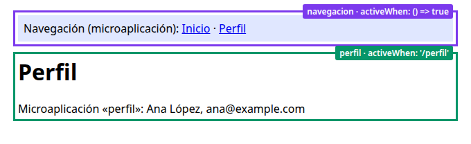

# Lab — Registrar microaplicaciones

[← Página anterior](00-root-config.md) · [Siguiente página →](02-lab-ciclo-de-vida.md)

En este laboratorio practicas **`registerApplication`**: cómo un [root-config](../glosario/04-integracion-despliegue.md#root-config) de [single-spa](../glosario/04-integracion-despliegue.md#single-spa) da de alta varias
[microaplicaciones](../glosario/01-arquitectura.md#microaplicacion) React y decide en qué rutas está cada una. El ejercicio tiene tres aplicaciones mínimas,
`navegacion`, `inicio` y `perfil`, cada una con su servidor; el root-config solo registra `inicio`, y tú
registras las otras dos con dos formas distintas de `activeWhen` hasta que conviven en la misma página.

### Objetivo

Comprender qué es registrar una microaplicación en single-spa: cómo funciona la función de carga y
`activeWhen`, cómo debe ser el contenedor donde se pinta, cómo se detecta lo que falla y cómo se mejora.

### Punto de partida

- Carpeta: `ejercicios/M05-01-registrar-microaplicaciones/inicio` (la terminada está en `…/solucion`).
- Arranque: `npm start` en esa carpeta (paso 1) levanta las cuatro aplicaciones.
- Puertos: root-config **3000** (el que abres); `navegacion` 3001, `inicio` 3002 y `perfil` 3003.
  Desde la pestaña **Puertos** de VS Code (icono del globo, «Abrir en el navegador»); fuera de Codespaces,
  `http://localhost:3000`.
- Herramientas: **F12** → pestañas **Red** (Network) y **Consola** (Console).
- Al abrir el puerto 3000 se ve la sección «Inicio»; en `/perfil` la página sale en blanco.

Si ya has tocado la carpeta y quieres volver a empezar:

```bash
# Deja inicio/ como está en el repositorio (ficha: ../comandos-lab.md#reiniciar)
cd /workspaces/react-microfrontends-201
bash scripts/reiniciar.sh M05-01-registrar-microaplicaciones
```

### Qué está pasando

En un proyecto real, cada equipo publica su microaplicación (la cabecera, la portada, el área de cliente) y un
root-config, que no es de ningún equipo de producto, decide qué se ve en cada URL. Registrar una aplicación es
darle tres datos: **cómo se llama**, **cómo se descarga su código** y **cuándo está activa**.

| Pieza | Fichero | Qué hace |
|-------|---------|----------|
| Root-config | `root-config/src/root-config.js` | Registra las aplicaciones y llama a `start()` |
| Disposición de la página | `root-config/public/index.html` | Un contenedor por aplicación, en el orden en que se verán |
| Microaplicación para single-spa | `<app>/src/spa.js` | Expone `bootstrap`, `mount` y `unmount` |
| Microaplicación aislada | `<app>/src/bootstrap.js` | Se pinta sola en `#root` cuando abres su puerto |

Cada microaplicación convierte su componente raíz en las funciones del [ciclo de vida](../glosario/04-integracion-despliegue.md#ciclo-de-vida) con `single-spa-react`
(`inicio/src/spa.js`):

```js
import React from 'react';
import ReactDOMClient from 'react-dom/client';
import singleSpaReact from 'single-spa-react';
import App from './App';

// single-spa-react convierte el componente raíz en las funciones del ciclo de vida.
export const { bootstrap, mount, unmount } = singleSpaReact({
  React,
  ReactDOMClient,
  rootComponent: App,
  // Si el componente falla, se pinta esto y el resto de la página sigue.
  errorBoundary: () => <p role="alert">inicio no está disponible</p>,
});
```

Ese `spa.js` es lo que cada aplicación expone por [Module Federation](../glosario/02-module-federation.md#module-federation) (`exposes: { './spa': './src/spa.js' }`),
y el root-config lo descarga con un `import()`:

```js
// root-config/src/root-config.js (punto de partida)
import { getMountedApps, registerApplication, start } from 'single-spa';

// Activa solo en la ruta raíz exacta.
registerApplication({
  name: 'inicio',
  app: () => import('inicio/spa'),
  activeWhen: (location) => location.pathname === '/',
});

// Pendiente: registrar perfil y navegacion.

window.addEventListener('single-spa:app-change', () => console.log('montadas:', getMountedApps().join(', ')));
start();
```

`single-spa-react` pinta cada aplicación en el elemento con id `single-spa-application:<nombre>`. El
`index.html` del root-config ya los declara, en este orden:

```html
<!-- Disposición de la página: un contenedor por microaplicación, en este orden.
     single-spa-react busca el elemento con id single-spa-application:<nombre>. -->
<div id="single-spa-application:navegacion"></div>
<div id="single-spa-application:inicio"></div>
<div id="single-spa-application:perfil"></div>
```

> [!NOTE]
> **El navegador solo habla con el root-config.** Los [remotes](../glosario/02-module-federation.md#remote) se piden en el mismo origen, bajo
> `/mf/<nombre>/` (por ejemplo `/mf/inicio/remoteEntry.js`), y el servidor del root-config los reenvía a su
> puerto con `devServer.proxy`. Así funciona igual en Codespaces, donde cada puerto es otro dominio, y en
> producción, con un único dominio.
>
> ```js
> // root-config/webpack.config.js
> proxy: [
>   { context: ['/mf/navegacion'], target: 'http://localhost:3001', pathRewrite: { '^/mf/navegacion': '' } },
>   { context: ['/mf/inicio'], target: 'http://localhost:3002', pathRewrite: { '^/mf/inicio': '' } },
>   { context: ['/mf/perfil'], target: 'http://localhost:3003', pathRewrite: { '^/mf/perfil': '' } },
> ],
> ```

> [!NOTE]
> **[Arranque asíncrono](../glosario/02-module-federation.md#arranque-asincrono).** `root-config/src/index.js` solo contiene `import('./root-config')`. Ese salto
> asíncrono da tiempo a Module Federation para negociar las [dependencias compartidas](../glosario/02-module-federation.md#shared) (React, react-dom,
> single-spa) antes de ejecutar el código que las usa. Las aplicaciones hacen lo mismo en su `index.js`
> con `import('./bootstrap')`.

### 1 — Arrancar el punto de partida

Levanta las cuatro aplicaciones y mira qué ocurre en las dos rutas antes de tocar nada.

```bash
# Arranca navegacion, inicio, perfil y root-config a la vez (ficha: ../comandos-lab.md#npm-start)
cd /workspaces/react-microfrontends-201/ejercicios/M05-01-registrar-microaplicaciones/inicio
npm start
```

**Resultado esperado** (el orden de las líneas puede cambiar):

```text
> concurrently -n navegacion,inicio,perfil,root-config "npm start --prefix navegacion" "npm start --prefix inicio" "npm start --prefix perfil" "npm start --prefix root-config"
[root-config] webpack 5.112.2 compiled successfully
[root-config] <i> [webpack-dev-server] Loopback: http://localhost:3000/, http://[::1]:3000/
[perfil] webpack 5.112.2 compiled successfully
[perfil] <i> [webpack-dev-server] Loopback: http://localhost:3003/, http://[::1]:3003/
[inicio] webpack 5.112.2 compiled successfully
[inicio] <i> [webpack-dev-server] Loopback: http://localhost:3002/, http://[::1]:3002/
[navegacion] webpack 5.112.2 compiled successfully
[navegacion] <i> [webpack-dev-server] Loopback: http://localhost:3001/, http://[::1]:3001/
```

Abre el puerto 3000 con **F12** → **Red** y **Consola** a la vista. En `/`:

```text
Red      200  /main.js
Red      200  /src_root-config_js.js
Red      200  /mf/inicio/remoteEntry.js
Red      200  /vendors-node_modules_single-spa_lib_es2015_esm_single-spa_dev_js.js
Red      200  /mf/inicio/vendors-node_modules_react_index_js.js
Red      200  /mf/inicio/vendors-node_modules_react-dom_index_js.js
Red      200  /mf/inicio/src_spa_js.js
Red      200  /mf/inicio/vendors-node_modules_react-dom_client_js-node_modules_react_jsx-dev-runtime_js.js
Consola  montadas: inicio
── Texto de la página:
Inicio

Microaplicación «inicio».
```

Escribe `/perfil` al final de la URL y pulsa Intro:

```text
Red      200  /main.js
Red      200  /src_root-config_js.js
Red      200  /mf/inicio/remoteEntry.js
Red      200  /vendors-node_modules_single-spa_lib_es2015_esm_single-spa_dev_js.js
── Texto de la página:

```

**Cómo se lee:** en `/` el `activeWhen` de `inicio` devuelve `true`, así que single-spa llama a su función de
carga: llegan su `remoteEntry.js`, React (servido por `inicio`, porque es quien lo aporta al reparto de
dependencias) y `src_spa_js.js`, que es su `spa.js`. En `/perfil` ninguna aplicación registrada está activa:
no se descarga nada de ninguna y la página queda vacía, **sin ningún error**. Eso es lo primero que hay que
saber de single-spa: una ruta sin aplicación no falla, simplemente no muestra nada.

### 2 — Registrar `perfil` con un prefijo de ruta

`perfil` tiene que verse en `/perfil` y en cualquier ruta que cuelgue de ella (`/perfil/datos`…). Un
`activeWhen` de tipo texto hace justo eso: es un prefijo. Añade el registro en
`root-config/src/root-config.js`, en lugar de la línea `// Pendiente: registrar perfil y navegacion.`:

```js
// Activa en /perfil y en cualquier ruta que empiece por /perfil.
registerApplication({
  name: 'perfil',
  app: () => import('perfil/spa'),
  activeWhen: '/perfil',
});
```

El `name` tiene que coincidir con el contenedor del `index.html` (`single-spa-application:perfil`) y
`'perfil/spa'` es el remote `perfil` declarado en `remotes` del `webpack.config.js` del root-config más el
módulo que expone.

**Resultado esperado:** al guardar, `[root-config]` vuelve a compilar (`compiled successfully`). Recarga
`/perfil`: ahora aparece la sección «Perfil» con el texto de `perfil/src/App.jsx`.

### 3 — Registrar `navegacion` siempre activa

La barra de navegación no depende de la ruta: tiene que estar en todas. Una función que siempre devuelve
`true` la mantiene montada. Añade este registro debajo del de `perfil`:

```js
// Activa siempre: la barra de navegación.
registerApplication({
  name: 'navegacion',
  app: () => import('navegacion/spa'),
  activeWhen: () => true,
});
```

Los enlaces de la barra (`navegacion/src/App.jsx`) usan `navigateToUrl` de single-spa: cambian la URL sin
recargar la página, y single-spa vuelve a evaluar los `activeWhen`.

```jsx
import { navigateToUrl } from 'single-spa';

// Barra de navegación: una microaplicación que está activa en todas las rutas.
export default function App() {
  return (
    <header style={{ background: '#e0e7ff', padding: 8 }}>
      Navegación (microaplicación):{' '}
      <a href="/" onClick={navigateToUrl}>Inicio</a> · <a href="/perfil" onClick={navigateToUrl}>Perfil</a>
    </header>
  );
}
```

Ya tienes las tres formas posibles de un [activeWhen](../glosario/04-integracion-despliegue.md#activewhen): función con condición exacta (`inicio`), texto como prefijo
(`perfil`) y función que siempre es cierta (`navegacion`).

### 4 — Comprobar las tres aplicaciones en la misma página

Guarda, vuelve a `/` y recarga con **Red** y **Consola** abiertas. Pulsa **Perfil** en la barra. Después,
en la **Consola**, escribe esta expresión para listar los hijos de `<body>`:

```js
// Lista los hijos de <body> por su id (o su etiqueta si no tienen id)
[...document.body.children].map(e => e.id || e.tagName).join(" | ")
```

Por último pulsa **Inicio**.

**Resultado esperado** (las peticiones pueden llegar en otro orden):

```text
Red      200  /main.js
Red      200  /src_root-config_js.js
Red      200  /mf/perfil/remoteEntry.js
Red      200  /mf/inicio/remoteEntry.js
Red      200  /mf/navegacion/remoteEntry.js
Red      200  /vendors-node_modules_single-spa_lib_es2015_esm_single-spa_dev_js.js
Red      200  /mf/perfil/vendors-node_modules_react_index_js.js
Red      200  /mf/inicio/src_spa_js.js
Red      200  /mf/perfil/vendors-node_modules_react-dom_index_js.js
Red      200  /mf/navegacion/src_spa_js.js
Red      200  /mf/inicio/vendors-node_modules_react-dom_client_js-node_modules_react_jsx-dev-runtime_js.js
Red      200  /mf/navegacion/vendors-node_modules_react-dom_client_js-node_modules_react_jsx-dev-runtime_js.js
Consola  montadas: inicio, navegacion
── Clic
Red      200  /mf/perfil/src_spa_js.js
Red      200  /mf/perfil/vendors-node_modules_react-dom_client_js-node_modules_react_jsx-dev-runtime_js.js
Consola  montadas: perfil, navegacion
── En la Consola:
single-spa-application:navegacion | single-spa-application:inicio | single-spa-application:perfil
── Clic
Consola  montadas: inicio, navegacion
── Texto de la página:
Navegación (microaplicación): Inicio · Perfil
Inicio

Microaplicación «inicio».
```

En `/perfil`, las dos aplicaciones montadas, cada una en su contenedor:



**Cómo se lee:**

| Qué ves | Qué significa |
|---------|---------------|
| Los tres `remoteEntry.js` al abrir `/`, también el de `perfil` | Para repartir React y single-spa, Module Federation lee al arrancar el `remoteEntry.js` de cada remote que aparece en algún `import()` del root-config (en el paso 1 solo había uno). Es solo el índice: el código de `perfil` no llega todavía |
| React servido desde `/mf/perfil/` | Las tres aplicaciones aportan la misma versión de React y se usa una sola copia; aquí ganó la de `perfil` |
| `src_spa_js.js` de `inicio` y `navegacion`, no de `perfil` | Solo se llama a la función de carga de las aplicaciones activas |
| Al pulsar **Perfil**, llega `/mf/perfil/src_spa_js.js` | La carga de `perfil` ocurre la primera vez que su `activeWhen` es cierto |
| `montadas: perfil, navegacion` | `inicio` se desmonta (su condición es `pathname === '/'`) y `navegacion` sigue |
| Al volver a **Inicio**, ninguna petición nueva | `inicio` ya estaba cargada: solo se vuelve a montar |
| El orden de los hijos de `<body>` | Es el del `index.html`: la barra arriba aunque se registró la última |

## Comprueba tu entendimiento

**La barra no se desmonta**
Pulsa **Perfil** e **Inicio** varias veces con la **Consola** abierta.
→ Cada línea `montadas:` termina en `navegacion`; solo alternan `inicio` y `perfil`.

**El prefijo de `perfil`**
Escribe `/perfil/datos` en la URL y pulsa Intro.
→ Se ve la sección «Perfil» bajo la barra: `'/perfil'` también coincide con las rutas que cuelgan de él.

**La condición exacta de `inicio`**
Escribe `/inicio` en la URL y pulsa Intro.
→ Solo se ve la barra: `inicio` está activa únicamente cuando `pathname` es exactamente `/`.

## Investiga

**¿Cada microaplicación sigue funcionando sola?** Abre el puerto **3002** (la aplicación `inicio`
directamente, sin root-config). Mira primero `inicio/src/index.js` y `inicio/src/bootstrap.js`: al abrirla
sola no se usa `spa.js`, sino `bootstrap.js`, que pinta en `#root`.

```text
Red      200  /main.js
Red      200  /remoteEntry.js
Red      200  /vendors-node_modules_react_index_js.js
Red      200  /src_bootstrap_js.js
Red      200  /vendors-node_modules_react-dom_index_js.js
Red      200  /vendors-node_modules_react-dom_client_js-node_modules_react_jsx-dev-runtime_js.js
── Texto de la página:
Inicio

Microaplicación «inicio».
```

Aquí se pide `src_bootstrap_js.js` y no `src_spa_js.js`. La misma aplicación tiene dos puertas: la de
single-spa (`spa.js`, expuesta por Module Federation) y la de desarrollo aislado (`bootstrap.js`). Eso es lo
que permite a un equipo trabajar en su microaplicación sin levantar las demás.

**¿Qué expone cada aplicación?** Abre en el navegador `/mf/perfil/remoteEntry.js` en el puerto 3000 y busca
`./spa` con **Ctrl+F**: es el único módulo que `perfil` publica.

## Experimenta

Sin los contenedores, `single-spa-react` crea el suyo al final de `<body>` cuando monta cada aplicación.

**Predice:** si borras los tres `<div id="single-spa-application:…">` de `root-config/public/index.html`,
¿en qué orden quedarán la barra y la sección «Inicio»?

Bórralos, guarda, recarga `/` y vuelve a lanzar en la **Consola** la expresión del paso 4.

```text
Red      200  /main.js
Red      200  /src_root-config_js.js
Red      200  /mf/perfil/remoteEntry.js
Red      200  /mf/navegacion/remoteEntry.js
Red      200  /mf/inicio/remoteEntry.js
Red      200  /vendors-node_modules_single-spa_lib_es2015_esm_single-spa_dev_js.js
Red      200  /mf/perfil/vendors-node_modules_react_index_js.js
Red      200  /mf/perfil/vendors-node_modules_react-dom_index_js.js
Red      200  /mf/inicio/src_spa_js.js
Red      200  /mf/navegacion/src_spa_js.js
Red      200  /mf/navegacion/vendors-node_modules_react-dom_client_js-node_modules_react_jsx-dev-runtime_js.js
Red      200  /mf/inicio/vendors-node_modules_react-dom_client_js-node_modules_react_jsx-dev-runtime_js.js
Consola  montadas: inicio, navegacion
── En la Consola:
single-spa-application:navegacion | single-spa-application:inicio
── Texto de la página:
Navegación (microaplicación): Inicio · Perfil
Inicio

Microaplicación «inicio».
```

**Cómo se lee:** solo existen los contenedores de las aplicaciones montadas, creados en el momento de montar.
En esta ejecución la barra quedó arriba, pero las dos aplicaciones se cargan a la vez y el orden depende de cuál
termina antes: fíjate en que las peticiones de `navegacion` e `inicio` llegan en otro orden que en el paso 4.
Nada garantiza la disposición. Vuelve a poner los tres `<div>` como estaban.

## Mejora

El `activeWhen` de `inicio` está escrito con una función porque un texto `'/'` sería un prefijo y coincidiría
con todas las rutas. Comprueba que lo has entendido cambiando temporalmente `navegacion` a
`activeWhen: '/'`: la barra sigue en todas las rutas, porque toda ruta empieza por `/`. Las dos formas son
equivalentes aquí; deja la función `() => true`, que dice la intención («siempre») sin depender de cómo se
interpreta el prefijo.

## Reto

### 1 — Una aplicación en dos rutas

**La situación:** se quiere que la sección de `perfil` responda también en `/cuenta`, porque hay enlaces
antiguos que apuntan allí. Alguien propone copiar el registro de `perfil` con otro nombre.

**Qué haces:** en `root-config/src/root-config.js`, cambia solo el `activeWhen` de `perfil` para que esté
activa en `/perfil` y en `/cuenta`, sin registrar una segunda aplicación.

**Pistas:** `activeWhen` admite también un array; cada elemento puede ser un texto (prefijo) o una función.

**Lo que buscas:** al escribir `/cuenta` en la URL, la **Consola** muestra `montadas: perfil, navegacion` y se
ve la sección «Perfil»; `/perfil` sigue funcionando igual.

<details>
<summary>Ver solución</summary>

```js
// Activa en /perfil, en /cuenta y en lo que cuelgue de cualquiera de las dos.
registerApplication({
  name: 'perfil',
  app: () => import('perfil/spa'),
  activeWhen: ['/perfil', '/cuenta'],
});
```

Copiar el registro con otro nombre crearía dos aplicaciones con el mismo código: dos `bootstrap`, dos árboles
de React y un contenedor nuevo que no está en el `index.html`. **La regla:** una aplicación se registra una
vez; todas las rutas donde aparece se describen en su `activeWhen`.

</details>

## Errores frecuentes

| Síntoma | Causa probable | Cómo arreglarlo |
|---------|----------------|-----------------|
| Una ruta sale en blanco y la **Consola** no muestra errores | Ninguna aplicación registrada tiene un `activeWhen` que coincida | Revisa los `activeWhen`; con `getMountedApps()` en la **Consola** ves cuáles están montadas |
| La aplicación aparece al final de la página, debajo de todo | Su `name` no coincide con el id del contenedor (`single-spa-application:<name>`) | Usa el mismo nombre en `registerApplication` y en el `index.html` |
| `Loading script failed` o `504` en `/mf/<nombre>/remoteEntry.js` | El servidor de esa aplicación no está en marcha | Arranca todo desde la carpeta del ejercicio (bloque de abajo) |
| La **Consola** avisa «single-spa has been loaded twice» | Alguna aplicación no comparte `single-spa` como `singleton` y trae su propia copia | Añade `'single-spa': { singleton: true }` a `shared` en su `webpack.config.js` y en el del root-config |
| Al pulsar un enlace la página se recarga entera | El enlace no usa `navigateToUrl` (o `singleSpaNavigate`) | Añade `onClick={navigateToUrl}` al `<a>` |
| `EADDRINUSE` al arrancar | Hay otro ejercicio en marcha en esos puertos | Páralo con `Ctrl+C` o libera los puertos (bloque de abajo) |

```bash
# Arranca las cuatro aplicaciones del ejercicio (ficha: ../comandos-lab.md#npm-start)
cd /workspaces/react-microfrontends-201/ejercicios/M05-01-registrar-microaplicaciones/inicio
npm start
```

```bash
# Libera los puertos de los ejercicios si otro proceso los ocupa
fuser -k 3000/tcp 3001/tcp 3002/tcp 3003/tcp
```

## Conclusiones

### Qué es registrar una microaplicación

Es decirle al root-config tres cosas de cada aplicación: su nombre, la función que descarga su código y la
condición de URL con la que está activa. A partir de `start()`, en cada cambio de ruta single-spa monta las
que pasan a estar activas y desmonta las que dejan de estarlo.

```text
URL ──▶ activeWhen de cada aplicación ──▶ app() la primera vez ──▶ mount en single-spa-application:<name>
```

### Cómo debe ser

| Requisito | En el lab |
|-----------|-----------|
| Un `registerApplication` por aplicación, con todas sus rutas en `activeWhen` | `inicio`, `perfil` y `navegacion`; reto con `['/perfil', '/cuenta']` |
| La función de carga es un `import()` del módulo que expone la aplicación | `() => import('perfil/spa')` |
| El tipo de `activeWhen` dice la intención | Función exacta para `/`, prefijo para `/perfil`, `() => true` para la barra |
| Un contenedor por aplicación en el `index.html` del root-config | Orden fijo: barra, inicio, perfil |
| React, react-dom y single-spa compartidos como `singleton` | Una sola copia de React, servida desde un remote |
| Cada aplicación se puede abrir sola | Puerto 3002 con `bootstrap.js` |

### Dónde se rompe y cómo lo has detectado

| Fallo | Cómo lo has visto | Qué provoca |
|-------|-------------------|-------------|
| Aplicación sin registrar | `/perfil` en blanco en el punto de partida, sin errores | Rutas vacías difíciles de diagnosticar |
| Contenedores ausentes | Experimenta: solo dos hijos en `<body>`, creados al montar | El orden depende de qué aplicación carga antes |
| Prefijo demasiado amplio | Mejora: `'/'` coincide con todas las rutas | Aplicaciones montadas donde no tocaba |

### Cómo se perfecciona

- Describir la disposición con `single-spa-layout` (rutas y contenedores en el HTML del root-config) en vez de
  repartir `activeWhen` por el código.
- Pasar datos comunes a todas las aplicaciones con `customProps` en `registerApplication`.
- Mostrar algo en una ruta sin aplicación (una página «no encontrada» registrada con su propio `activeWhen`).
- En la variante canónica de single-spa, sustituir los `remotes` por un [import map](../glosario/01-arquitectura.md#import-map) para cambiar la URL de una
  aplicación sin recompilar el root-config.

### En una frase

> 🔑 Registrar es dar nombre, carga y ruta: el nombre fija dónde se pinta, la carga cuándo se descarga y
> `activeWhen` cuándo existe.
