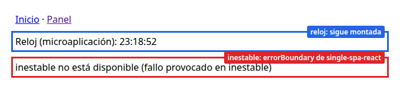

# Lab — Ciclo de vida

[← Página anterior](01-lab-registrar-microaplicaciones.md) · [Siguiente página →](03-lab-carga-y-precarga.md)

En este laboratorio practicas el **[ciclo de vida](../glosario/04-integracion-despliegue.md#ciclo-de-vida) con `single-spa-react`**: cuándo llama [single-spa](../glosario/04-integracion-despliegue.md#single-spa) a
`bootstrap`, `mount` y `unmount` de cada [microaplicación](../glosario/01-arquitectura.md#microaplicacion) y qué pasa cuando una de ellas falla. El ejercicio
tiene dos aplicaciones: `reloj`, que está siempre visible y cambia cada segundo, e `inestable`, que solo está
en `/panel` y tiene un botón que provoca un error. Primero ves cómo el fallo deja a `inestable` bloqueada;
después trazas el ciclo de vida, aíslas el fallo y lo recoges desde el [root-config](../glosario/04-integracion-despliegue.md#root-config).

### Objetivo

Comprender el ciclo de vida de una microaplicación en single-spa: cómo funciona cada fase, cómo debe
prepararse una aplicación para fallar sola, cómo se detecta un fallo de render o de carga y cómo se mejora.

### Punto de partida

- Carpeta: `ejercicios/M05-02-ciclo-de-vida/inicio` (la terminada está en `…/solucion`).
- Arranque: `npm start` en esa carpeta (paso 1) levanta `reloj` (3001), `inestable` (3002) y el root-config (3000).
- URL: puerto **3000**, desde la pestaña **Puertos** de VS Code (icono del globo, «Abrir en el navegador»);
  fuera de Codespaces, `http://localhost:3000`.
- Herramientas: **F12** → pestañas **Consola** (Console) y **Red** (Network).
- Al abrir se ve la barra «Inicio · Panel» y el reloj en marcha.

Si ya has tocado la carpeta y quieres volver a empezar:

```bash
# Deja inicio/ como está en el repositorio (ficha: ../comandos-lab.md#reiniciar)
cd /workspaces/react-microfrontends-201
bash scripts/reiniciar.sh M05-02-ciclo-de-vida
```

### Qué está pasando

En una página hecha de microaplicaciones, cada una tiene su propio árbol de React y su propio equipo. Que una
falle es cuestión de tiempo; lo que importa es que su fallo se quede en su trozo de página y que el root-config
se entere. single-spa gestiona cada aplicación con tres funciones:

| Fase | Cuándo la llama single-spa | Qué hace `single-spa-react` |
|------|----------------------------|-----------------------------|
| `bootstrap` | Una vez, la primera vez que la aplicación debe estar activa | Prepara la aplicación |
| `mount` | Cada vez que su `activeWhen` pasa a ser cierto | Crea el árbol de React en su contenedor y lo pinta |
| `unmount` | Cada vez que su `activeWhen` deja de ser cierto | Desmonta el árbol de React |

Cada fase devuelve una promesa y single-spa espera a que se resuelva. Si no se resuelve en 3000 ms, avisa en la
**Consola** (aviso #31) y sigue esperando: mientras tanto, esa aplicación no puede volver a montarse.

El root-config del punto de partida (`root-config/src/root-config.js`) solo registra las dos aplicaciones:

```js
import { registerApplication, start } from 'single-spa';

registerApplication({ name: 'reloj', app: () => import('reloj/spa'), activeWhen: '/' });
registerApplication({ name: 'inestable', app: () => import('inestable/spa'), activeWhen: '/panel' });

start();
```

`activeWhen: '/'` es un prefijo: `reloj` está activa en todas las rutas. El componente de `inestable`
(`inestable/src/App.jsx`) lanza un error al pulsar el botón:

```jsx
import { useState } from 'react';

// Una microaplicación con un fallo que se puede provocar.
export default function App() {
  const [roto, setRoto] = useState(false);
  if (roto) throw new Error('fallo provocado en inestable');
  return (
    <p>
      Inestable (microaplicación) <button onClick={() => setRoto(true)}>Provocar fallo</button>
    </p>
  );
}
```

> [!NOTE]
> **El navegador solo habla con el root-config.** Los [remotes](../glosario/02-module-federation.md#remote) se piden bajo `/mf/<nombre>/` en el puerto 3000 y
> el servidor del root-config los reenvía al puerto de cada aplicación (`devServer.proxy` en
> `root-config/webpack.config.js`). Así funciona igual en Codespaces y detrás de un único dominio en producción.

### 1 — Provocar el fallo sin protección

Arranca las tres aplicaciones y mira qué le pasa a `inestable` cuando falla sin ninguna protección.

```bash
# Arranca reloj, inestable y root-config a la vez (ficha: ../comandos-lab.md#npm-start)
cd /workspaces/react-microfrontends-201/ejercicios/M05-02-ciclo-de-vida/inicio
npm start
```

**Resultado esperado** (el orden de las líneas puede cambiar):

```text
> concurrently -n reloj,inestable,root-config "npm start --prefix reloj" "npm start --prefix inestable" "npm start --prefix root-config"
[root-config] webpack 5.112.2 compiled successfully
[root-config] <i> [webpack-dev-server] Loopback: http://localhost:3000/, http://[::1]:3000/
[inestable] webpack 5.112.2 compiled successfully
[reloj] webpack 5.112.2 compiled successfully
[inestable] <i> [webpack-dev-server] Loopback: http://localhost:3002/, http://[::1]:3002/
[reloj] <i> [webpack-dev-server] Loopback: http://localhost:3001/, http://[::1]:3001/
```

Abre el puerto 3000 con la **Consola** a la vista y haz esto, en orden:

1. Pulsa **Panel**.
2. Pulsa **Provocar fallo**.
3. Pulsa **Inicio** y espera unos 4 s (más de los 3000 ms del límite).
4. Pulsa **Panel** otra vez.

**Resultado esperado** (la hora del reloj cambia en cada ejecución):

```text
Red      200  /main.js
Red      200  /src_root-config_js.js
Red      200  /mf/inestable/remoteEntry.js
Red      200  /mf/reloj/remoteEntry.js
Red      200  /vendors-node_modules_single-spa_lib_es2015_esm_single-spa_dev_js.js
Red      200  /mf/reloj/vendors-node_modules_react-dom_index_js.js
Red      200  /mf/reloj/vendors-node_modules_react_index_js.js
Red      200  /mf/reloj/src_spa_js.js
Red      200  /mf/reloj/vendors-node_modules_react-dom_client_js-node_modules_react_jsx-dev-runtime_js.js
── Clic
Red      200  /mf/inestable/src_spa_js.js
Red      200  /mf/inestable/vendors-node_modules_react-dom_client_js-node_modules_react_jsx-dev-runtime_js.js
Consola (aviso)  single-spa-react: inestable's rootComponent should implement componentDidCatch to avoid accidentally unmounting the entire single-spa application.
── Clic
Consola (error)  Uncaught fallo provocado en inestable
Consola (aviso)  %s

%s
 An error occurred in the <App> component. Consider adding an error boundary to your tree to customize error handling behavior.
Visit https://react.dev/link/error-boundaries to learn more about error boundaries.
── Clic
Consola (aviso)  single-spa minified message #31: Lifecycle function unmount for application inestable lifecycle did not resolve or reject for 3000 ms. See https://single-spa.js.org/error/?code=31&arg=unmount&arg=application&arg=inestable&arg=3000
Consola (aviso)  single-spa minified message #31: Lifecycle function unmount for application inestable lifecycle did not resolve or reject for 3000 ms. See https://single-spa.js.org/error/?code=31&arg=unmount&arg=application&arg=inestable&arg=3000
Consola (error)  single-spa minified message #31: Lifecycle function unmount for application inestable lifecycle did not resolve or reject for 3000 ms. See https://single-spa.js.org/error/?code=31&arg=unmount&arg=application&arg=inestable&arg=3000
── Clic
── Texto de la página:
Inicio · Panel

Reloj (microaplicación): 12:24:28
```

**Cómo se lee:**

| Momento | Qué ocurre |
|---------|------------|
| Al montar `inestable` | `single-spa-react` ya avisa: sin `componentDidCatch` (un error boundary), un fallo desmonta la aplicación entera |
| **Provocar fallo** | React no encuentra ningún error boundary y destruye el árbol de `inestable` |
| **Inicio** | single-spa llama a `unmount`. `single-spa-react` espera a que su árbol termine de desmontarse, pero React ya lo había destruido: la promesa no se resuelve nunca. Pasados 3000 ms, aviso #31 (varias veces mientras sigue esperando) |
| **Panel** otra vez | Nada: `inestable` sigue atascada en `unmount` y no puede volver a montarse |
| `reloj` | Sigue en marcha todo el rato: su árbol de React es otro |

El fallo no ha tumbado la página, pero `inestable` ha quedado inservible hasta recargar, y el root-config no
se ha enterado de nada. Además, sin trazas no sabes qué fases se han llamado. Deja `npm start` en marcha: los
pasos siguientes recompilan solos al guardar.

### 2 — Trazar las fases desde el root-config

Para ver cuándo llama single-spa a cada fase, envuelve las funciones que exporta cada aplicación. La función
de carga devuelve el módulo con `bootstrap`, `mount` y `unmount`; `conTraza` devuelve otro objeto con las
mismas tres funciones, que escriben en la **Consola** y llaman a la original. Sustituye los dos
`registerApplication` de `root-config/src/root-config.js` por esto:

```js
// Envuelve las funciones del ciclo de vida para ver en la consola cuándo las llama single-spa.
function conTraza(nombre, ciclo) {
  const traza = (fase) => async (props) => {
    console.log(`[${nombre}] ${fase}`);
    return ciclo[fase](props);
  };
  return { bootstrap: traza('bootstrap'), mount: traza('mount'), unmount: traza('unmount') };
}

registerApplication({ name: 'reloj', app: () => import('reloj/spa').then((m) => conTraza('reloj', m)), activeWhen: '/' });
registerApplication({ name: 'inestable', app: () => import('inestable/spa').then((m) => conTraza('inestable', m)), activeWhen: '/panel' });
```

Recarga la página (así `inestable` vuelve a empezar) y pulsa **Panel**.

**Resultado esperado** (recortado: solo la **Consola**; sigue apareciendo además el aviso de `single-spa-react`
del paso 1, que desaparece en el paso 3):

```text
Consola  [reloj] bootstrap
Consola  [reloj] mount
── Clic
Consola  [inestable] bootstrap
Consola  [inestable] mount
```

**Cómo se lee:** al abrir la página solo está activa `reloj`: se descarga, se prepara y se monta. Al pulsar
**Panel**, `inestable` pasa por lo mismo. `reloj` no recibe ninguna llamada: sigue montada porque su
`activeWhen` sigue siendo cierto.

### 3 — Aislar el fallo con un `errorBoundary`

`single-spa-react` puede envolver el componente raíz en un error boundary: si el componente falla, pinta en su
contenedor lo que devuelva `errorBoundary`, y el árbol sigue vivo para desmontarse con normalidad. Añádelo en
`inestable/src/spa.js`, debajo de `rootComponent: App,`:

```js
import React from 'react';
import ReactDOMClient from 'react-dom/client';
import singleSpaReact from 'single-spa-react';
import App from './App';

// single-spa-react convierte el componente raíz en las funciones del ciclo de vida.
export const { bootstrap, mount, unmount } = singleSpaReact({
  React,
  ReactDOMClient,
  rootComponent: App,
  // Si el componente falla, se pinta esto en su contenedor y el resto de la página sigue.
  errorBoundary: (error) => <p role="alert">inestable no está disponible ({error.message})</p>,
});
```

Recarga, pulsa **Panel** y **Provocar fallo**.

**Resultado esperado** (recortado: sin las peticiones del arranque; la hora cambia en cada ejecución):

```text
Consola  [reloj] bootstrap
Consola  [reloj] mount
── Clic
Red      200  /mf/inestable/src_spa_js.js
Red      200  /mf/inestable/vendors-node_modules_react-dom_client_js-node_modules_react_jsx-dev-runtime_js.js
Consola  [inestable] bootstrap
Consola  [inestable] mount
── Clic
Consola (error)  %o

%s

%s
 Error: fallo provocado en inestable The above error occurred in the <App> component. React will try to recreate this component tree from scratch using the error boundary you provided, SingleSpaReactErrorBoundary(inestable).
── Texto de la página:
Inicio · Panel

Reloj (microaplicación): 12:24:51

inestable no está disponible (fallo provocado en inestable)
```



**Cómo se lee:** el aviso de `componentDidCatch` ya no sale al montar. El error sigue apareciendo en la
**Consola**, pero ahora React dice que lo recoge el error boundary `SingleSpaReactErrorBoundary(inestable)`, y
en el sitio de `inestable` se lee el mensaje de `errorBoundary` con el texto del error. El reloj sigue
avanzando.

### 4 — Enterarse en el root-config cuando una aplicación no carga

Un `errorBoundary` recoge errores **de render**. Los errores **del ciclo de vida** (no poder descargar la
aplicación, un `mount` que falla) los entrega single-spa a los manejadores de `addErrorHandler`.
`getAppStatus` dice en qué estado ha quedado la aplicación. En `root-config/src/root-config.js`, amplía el
`import` de la primera línea y añade el manejador antes de `start()`:

```js
import { addErrorHandler, getAppStatus, registerApplication, start } from 'single-spa';
```

```js
// Errores del ciclo de vida (no del render): single-spa los entrega aquí.
addErrorHandler((err) => console.log(`[root] error en ${err.appOrParcelName}: ${getAppStatus(err.appOrParcelName)}`));
```

Para provocar un error de carga, para solo el servidor de `inestable`. En una **segunda terminal**:

```bash
# Para el servidor de desarrollo de inestable (puerto 3002); los demás siguen en marcha
fuser -k 3002/tcp
```

Recarga la página en el puerto 3000 y pulsa **Panel**.

**Resultado esperado** (la hora cambia en cada ejecución):

```text
Red      200  /main.js
Consola (error)  Failed to load resource: the server responded with a status of 504 (Gateway Timeout)
Red      falló  http://localhost:3000/mf/inestable/remoteEntry.js
Consola (aviso)  Initialization of sharing external failed: ScriptExternalLoadError: Loading script failed.
(error: http://localhost:3000/mf/inestable/remoteEntry.js)
Red      200  /src_root-config_js.js
Red      200  /mf/reloj/remoteEntry.js
Red      200  /vendors-node_modules_single-spa_lib_es2015_esm_single-spa_dev_js.js
Red      200  /mf/reloj/src_spa_js.js
Red      200  /mf/reloj/vendors-node_modules_react-dom_index_js.js
Red      200  /mf/reloj/vendors-node_modules_react_index_js.js
Red      200  /mf/reloj/vendors-node_modules_react-dom_client_js-node_modules_react_jsx-dev-runtime_js.js
Consola  [reloj] bootstrap
Consola  [reloj] mount
── Clic
Consola  [root] error en inestable: LOAD_ERROR
── Texto de la página:
Inicio · Panel

Reloj (microaplicación): 12:25:00
```

**Cómo se lee:**

| Línea | Qué significa |
|-------|---------------|
| `504` en `/mf/inestable/remoteEntry.js` | El proxy del root-config no encuentra a nadie en el puerto 3002 |
| `Initialization of sharing external failed` | [Module Federation](../glosario/02-module-federation.md#module-federation) no ha podido leer ese `remoteEntry.js` al repartir React; sigue con los remotes que sí responden |
| `[reloj] bootstrap`, `[reloj] mount` | La otra aplicación arranca como siempre |
| `[root] error en inestable: LOAD_ERROR` | Al pulsar **Panel**, la función de carga de `inestable` falla; single-spa la deja en `LOAD_ERROR` y avisa al manejador |

Para volver a tener las tres aplicaciones, para `npm start` con `Ctrl+C` en su terminal y arráncalo otra vez:

```bash
# Arranca de nuevo las tres aplicaciones (ficha: ../comandos-lab.md#npm-start)
cd /workspaces/react-microfrontends-201/ejercicios/M05-02-ciclo-de-vida/inicio
npm start
```

## Comprueba tu entendimiento

**`bootstrap` ocurre una vez**
Con las trazas puestas, pulsa **Panel**, **Inicio** y **Panel**.
→ `[inestable] bootstrap` aparece solo la primera vez; después alternan `[inestable] unmount` y `[inestable] mount`.

**El reloj no se entera**
Navega entre **Inicio** y **Panel** varias veces.
→ No aparece ninguna línea nueva de `[reloj]`: está activa en todas las rutas y no se desmonta nunca.

**El fallo queda en su sitio**
Pulsa **Panel** y **Provocar fallo**.
→ En el sitio de `inestable` se lee «inestable no está disponible (fallo provocado en inestable)» y el reloj sigue avanzando.

## Investiga

**¿Qué dice exactamente el aviso #31?** single-spa publica sus mensajes abreviados en producción y los explica
en su web. Abre la URL que aparece al final del aviso del paso 1:

```text
https://single-spa.js.org/error/?code=31&arg=unmount&arg=application&arg=inestable&arg=3000
```

Los `arg=` son los huecos del mensaje: la fase (`unmount`), el tipo (`application`), el nombre (`inestable`) y
el límite en milisegundos (`3000`). Busca en esa página cómo se cambia ese límite para una aplicación y qué
significa que no sea «fatal» (por defecto, single-spa avisa y sigue esperando).

## Experimenta

Con el `errorBoundary` puesto, `inestable` ha fallado y muestra su mensaje de error.

**Predice:** si pulsas **Inicio** y después **Panel**, ¿qué se verá en el sitio de `inestable`: el mensaje de
error o el botón? ¿Aparecerá otra vez `[inestable] bootstrap`?

Compruébalo:

```text
── Clic
Consola  [inestable] unmount
── Clic
Consola  [inestable] mount
── Texto de la página:
Inicio · Panel

Reloj (microaplicación): 12:24:55

Inestable (microaplicación) Provocar fallo
```

**Cómo se lee:** el `unmount` se resuelve al momento (no hay aviso #31) y el `mount` siguiente crea un árbol de
React nuevo, con el estado inicial: vuelve el botón. No hay `bootstrap`, porque solo se hace una vez. Compara
con el paso 1, donde la aplicación quedó atascada para siempre.

## Reto

### 1 — El nombre viene en las props

**La situación:** `conTraza` recibe el nombre de la aplicación como parámetro, y hay que escribirlo dos veces
en cada registro (`name: 'reloj'` y `conTraza('reloj', m)`). Alguien propone quitar esa repetición.

**Qué haces:** cambia `conTraza` para que reciba solo el módulo (`conTraza(m)`) y saque el nombre de lo que
single-spa le pasa a cada fase. Ajusta los dos `registerApplication`, recarga y pulsa **Panel**.

**Pistas:** cada función del ciclo de vida recibe un objeto `props`; entre sus campos está `name`.

**Lo que buscas:** la **Consola** muestra exactamente las mismas trazas que en el paso 2, sin escribir el nombre
en `conTraza`.

<details>
<summary>Ver solución</summary>

```js
// El nombre llega en props.name: single-spa lo pasa a cada fase.
function conTraza(ciclo) {
  const traza = (fase) => async (props) => {
    console.log(`[${props.name}] ${fase}`);
    return ciclo[fase](props);
  };
  return { bootstrap: traza('bootstrap'), mount: traza('mount'), unmount: traza('unmount') };
}

registerApplication({ name: 'reloj', app: () => import('reloj/spa').then(conTraza), activeWhen: '/' });
registerApplication({ name: 'inestable', app: () => import('inestable/spa').then(conTraza), activeWhen: '/panel' });
```

```text
Consola  [reloj] bootstrap
Consola  [reloj] mount
── Clic
Consola  [inestable] bootstrap
Consola  [inestable] mount
```

Las trazas no cambian porque `props.name` es el `name` del registro. **La regla:** single-spa pasa a cada fase
sus props (el nombre y las `customProps` del registro, entre otras); lo que una aplicación necesita saber del
root-config debe llegarle por ahí y no repetido a mano.

</details>

## Errores frecuentes

| Síntoma | Causa probable | Cómo arreglarlo |
|---------|----------------|-----------------|
| Aviso «rootComponent should implement componentDidCatch» al montar | La aplicación no tiene `errorBoundary` | Añade `errorBoundary` en su `spa.js` |
| Aviso #31 «did not resolve or reject for 3000 ms» y la aplicación no vuelve | Su árbol de React se destruyó por un error sin error boundary y `unmount` no termina | `errorBoundary` en la aplicación; recarga la página para desbloquearla |
| No aparece ninguna traza `[nombre] …` | La función de carga devuelve el módulo sin envolver | Comprueba el `.then((m) => conTraza('…', m))` en el `registerApplication` |
| `addErrorHandler` no recoge el fallo del botón | Es un error de render: lo recoge el `errorBoundary`, no single-spa | Es lo esperado; `addErrorHandler` solo ve errores del ciclo de vida (`LOAD_ERROR`…) |
| `ReferenceError: addErrorHandler is not defined` | Falta en el `import` de `single-spa` | Añádelo a la primera línea de `root-config.js` |
| Tras parar `inestable`, sigue sin cargar al arrancarlo | La página aún tiene el estado `LOAD_ERROR` | Recarga la página después de arrancar de nuevo (bloque de abajo) |

```bash
# Vuelve a arrancar todas las aplicaciones del ejercicio (ficha: ../comandos-lab.md#npm-start)
cd /workspaces/react-microfrontends-201/ejercicios/M05-02-ciclo-de-vida/inicio
npm start
```

## Conclusiones

### Qué es el ciclo de vida con `single-spa-react`

Son las tres promesas con las que single-spa gobierna cada aplicación: `bootstrap` una sola vez, `mount` y
`unmount` en cada navegación. `single-spa-react` las implementa creando y destruyendo un árbol de React en el
contenedor de la aplicación; entre `mount` y `unmount`, React renderiza por su cuenta.

```text
carga ─▶ bootstrap ─▶ mount ⇄ unmount
  │                     │
  └ LOAD_ERROR ─▶ addErrorHandler      error de render ─▶ errorBoundary
```

### Cómo debe ser

| Requisito | En el lab |
|-----------|-----------|
| Cada aplicación declara `errorBoundary` | `inestable` pinta «no está disponible (…)» y sigue desmontándose bien |
| El root-config registra un `addErrorHandler` | `[root] error en inestable: LOAD_ERROR` con el remote parado |
| Las fases se pueden observar | `conTraza`: `bootstrap` una vez, `mount`/`unmount` al navegar |
| El fallo de una aplicación no afecta a las demás | El reloj sigue en los tres casos: fallo sin protección, con protección y remote parado |

### Dónde se rompe y cómo lo has detectado

| Fallo | Cómo lo has visto | Qué provoca |
|-------|-------------------|-------------|
| Error de render sin error boundary | Paso 1: aviso #31 a los 3000 ms y **Panel** ya no hace nada | La aplicación queda inservible hasta recargar |
| Servidor de una aplicación parado | Paso 4: `504` en su `remoteEntry.js` y `LOAD_ERROR` | Esa ruta queda vacía; el resto funciona |
| Fallo sin aviso al root-config | Paso 1: ninguna línea del root-config | Nadie se entera salvo quien mire la **Consola** |

### Cómo se perfecciona

- Enviar los errores de `addErrorHandler` y de `errorBoundary` a un servicio de monitorización, con el nombre
  de la aplicación.
- Mostrar en el root-config un aviso o un contenido alternativo cuando una aplicación queda en `LOAD_ERROR`.
- Ajustar los límites de tiempo de cada fase (el `timeouts` que puede exportar cada aplicación) y decidir si
  agotarlos debe marcar la aplicación como rota.
- Usar `customProps` para pasar a cada aplicación lo que necesite del root-config.

### En una frase

> 🔑 single-spa decide cuándo existe cada aplicación y React cómo se pinta; el `errorBoundary` mantiene el
> fallo dentro de su árbol y `addErrorHandler` hace que el root-config se entere de lo que no llega a pintarse.
